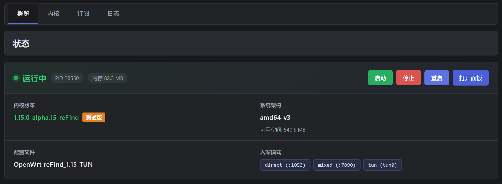

<div align="center">

# luci-app-wrtbox


**专为 OpenWrt 25+ 打造的 sing-box 社区版网页管理插件**

[-00B5E2?style=flat-square&logo=openwrt&logoColor=white)](https://openwrt.org/)
[](https://github.com/reF1nd/sing-box-releases)
[-2EA44F?style=flat-square)](#安装方式)
[](Makefile)

</div>

---

## 插件界面效果

<div align="center">
  
</div>

---

## 安装方式

> [!IMPORTANT]
> **适用系统**：**OpenWrt 25.x.x 及以上版本**  
> 本插件采用 **`apk` 安装包格式，全架构通用（x86_64 / ARM64 / ARM 等平台均可直接安装）**，内核会在网页端按设备架构自动匹配下载。

1. 从本项目的 **Releases** 或 **Actions** 下载 `luci-app-wrtbox-*.apk` 安装包。
2. 上传到路由器 `/tmp` 目录后，在终端运行：

```sh
apk add --allow-untrusted /tmp/luci-app-wrtbox-*.apk
```

3. 刷新路由器后台页面，进入 **服务 → WrtBox** 即可使用。

---

## 依赖说明（sing-box 运行环境）

由于本插件默认不强绑定所有内核模块，请根据你配置文件中使用的入站模式提前安装对应依赖（OpenWrt 25+ 使用 `apk`）：

| 依赖包 | 适用场景 | 说明 |
| :--- | :--- | :--- |
| `kmod-tun` | **TUN 模式** | 创建 `tun` 虚拟网卡，使用 `tun` 入站时必装 |
| `kmod-inet-diag` | **基础诊断 / 进程匹配** | Socket 状态查询与连接信息诊断，建议必装 |
| `kmod-nft-tproxy` | **TProxy 透明代理** | 使用 `tproxy` 入站配合 `nftables` 劫持流量时必装 |
| `kmod-nft-socket` | **TProxy / Socket 匹配** | 配合 `tproxy` 识别本地 Socket 防止回环时必装 |
| `kmod-nft-queue` | **NFQUEUE 队列** | 使用基于 `nftables` `queue` 转发的规则时必装 |
| `ip-full` | **策略路由（推荐）** | 提供完整 `ip rule` / `ip route` 支持，部分 `tun` 路由场景建议安装 |
| `ca-bundle` | **TLS 证书** | HTTPS 订阅拉取与 TLS 校验（安装本插件时已自动附带） |

### 一键安装常用依赖

```sh
apk update
apk add kmod-tun kmod-inet-diag kmod-nft-tproxy kmod-nft-socket kmod-nft-queue ip-full ca-bundle
```

> [!NOTE]
> - 如果你仅使用 **TUN 模式**，通常安装 `kmod-tun kmod-inet-diag ip-full` 即可；如需同时兼容 TProxy / NFQUEUE 规则，建议全部安装。
> - 部分第三方固件已将 `TUN` 或 `NFT_TPROXY` 直接编译进内核，或需与固件内核版本一致才能安装 `kmod-*`；若提示内核版本不匹配，请使用对应固件软件源或自行确认内核已内置相关特性。

---

## 目录说明

| 用途 | 路径 |
| :--- | :--- |
| **内核位置（默认）** | `/usr/libexec/wrtbox/sing-box`（可在设置中自定义） |
| **配置文件目录** | `/etc/wrtbox/profiles/`（存放上传或订阅拉取的 JSON） |
| **当前运行配置** | `/etc/wrtbox/active.json`（失败回滚备份为 `active.json.bak`） |
| **插件设置文件** | `/etc/config/wrtbox` |
