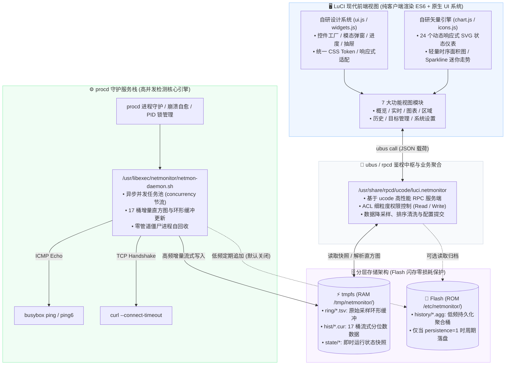

<div align="center">

# 🌐 luci-app-netmonitor

<p align="center">
  <strong>面向 OpenWrt 主线（Mainline）的高性能网络延迟与连通性实时监控系统</strong>
</p>

<p align="center">
  <a href="https://github.com/LianXia233/luci-app-netmonitor/releases/latest"></a>
  <a href="https://openwrt.org/"></a>
  <a href="Makefile"></a>
  <a href="https://github.com/LianXia233/luci-app-netmonitor/releases/latest"></a>
  <a href="tests/"></a>
  <a href="po/"></a>
  <a href="LICENSE"></a>
  <a href="https://github.com/LianXia233/luci-app-netmonitor/stargazers"></a>
</p>

<p align="center">
  <em>基于 procd 常驻守护进程与轻量 tmpfs 直方图存储 · 关闭网页后台持续采样 · 拒绝虚假 0ms 延迟 · 零闪存写放大</em>
</p>

<p align="center">
  <a href="#features">✨ 核心特性</a> •
  <a href="#architecture">📊 架构全景</a> •
  <a href="#views">🖥️ 监控视图</a> •
  <a href="#quick-start">🚀 快速上手</a> •
  <a href="#config">⚙️ 配置参考</a> •
  <a href="#storage">🗄️ 存储机制</a> •
  <a href="#best-practices">🛠️ 避坑指南</a> •
  <a href="#tests">🧪 自动化测试</a>
</p>

---

</div>

> [!TIP]
> 💡 **全架构通用**：本项目采用 `PKGARCH=all` 纯净绿色架构，无需针对不同 CPU 架构单独交叉编译，单一构建制品（`.apk` / `.ipk`）可直接安装于所有硬件平台（x86_64、aarch64、mips 等）！

---

<a id="features"></a>
## ✨ 核心特性

- ⚡ **后台解耦常驻**：
  由 `procd` 进程管理器托管常驻后台探测服务，前端浏览器仅在打开页面时按需拉取渲染。关闭页面或多标签同时访问绝不造成后台重复探测或资源浪费。
- 🎯 **ICMP / TCP 双模精准探测**：
  逐目标自由配置探测方式：支持标准 **ICMP Echo**，以及在阻断 Ping 的特殊网络环境下通过 **TCP 三次握手**（默认端口 80，支持按目标自定义）测量真实端到端连接时延。
- 📊 **严谨硬核的数据口径（拒绝虚假 0ms）**：
  严格区分连接超时、DNS 解析失败、网络不可达与协议异常；失败点延迟严格记录为 `null`，**绝不以虚假的 `0 ms` 伪造假象**，杜绝拉低平均值引发统计失真。
- 🧮 **$O(1)$ 流式直方图与高分位数估算**：
  基于内存环形缓冲区与 17 桶动态直方图进行毫秒级增量计算，实时输出 **P50 / P95 / P99** 分位数与抖动指标，CPU 消耗与历史运行时长彻底解耦。
- 🛡️ **Flash 零损耗设计**：
  高频时序采样点阵全量驻留于内存虚拟文件系统（`tmpfs`），仅可选开启低频聚合落盘；无任何磁盘写放大风险，有效保护路由器闪存寿命。
- 🎨 **自研零依赖原生设计系统**：
  彻底告别体积臃肿的第三方 UI 框架（前端包体仅 159 KB）；由自研 `ui.js` 提供九大控件工厂、模态弹窗、侧滑抽屉与通知系统；内置 24 个动态响应式 SVG 状态仪表与多维度时序图表。
- 🌐 **双栈网络智能偏好**：
  支持全局或逐目标配置 `auto` / `ipv4` / `ipv6` / `both` 路由偏好。在 `both` 双栈模式下，优先探测 IPv4，失败自动回退至 IPv6，任一协议栈可达即判定为服务可用。

---

<a id="architecture"></a>
## 📊 系统架构全景



---

<a id="views"></a>
## 🖥️ 7 大 LuCI Web 监控视图一览

本插件在 LuCI 控制台「**状态 ➔ 网络质量监控**」下提供 7 个全功能视图：

| 视图模块 | 对应源码 | 核心功能与亮点 |
| :--- | :--- | :--- |
| 📊 **监控概览** | `overview.js` | 全景 KPI 卡片、全局连通率、平均时延、异常告警横幅、迷你走势图（Sparkline）及目标状态矩阵 |
| ⚡ **实时监控** | `realtime.js` | 高频秒级动态折线图，实时呈现当前时延抖动，配合 SVG 动态脉冲仪表盘直观展现链路波动 |
| 📈 **多维图表** | `charts.js` | 汇集各目标时延走势对比、丢包率分布直方图，以及 P50 / P95 / P99 核心分位数多维对比 |
| 🗺️ **区域质量** | `regions.js` | 按区域分组（国内 CN / 港澳台及海外 Overseas / 自定义）对比网络质量雷达与平均可用率 |
| 📜 **时序历史** | `history.js` | 支持 1h / 6h / 24h / 7d / 30d 多区间筛选，平滑降采样时序点阵与丢包异常事件回溯 |
| 🎯 **目标管理** | `targets.js` | 目标声明与编辑抽屉；自由定义名称、主机/IP、探测协议（ICMP/TCP）、目标端口及绑定出口网卡 |
| ⚙️ **系统设置** | `settings.js` | 全局探测周期、并发数上限、超时阈值、双栈偏好、连续告警阈值及 Flash 持久化参数调优 |

---

<a id="quick-start"></a>
## 🚀 快速上手与验证

由于安装包架构为 `PKGARCH=all`，无需区分路由器芯片型号，全架构通用：

### 1. 包管理器在线或离线安装

#### 方案 A：OpenWrt 25.x / ImmortalWrt SNAPSHOT (`apk` 系统)

```bash
# 在线安装（如已配置软件源）
apk update
apk add luci-app-netmonitor luci-i18n-netmonitor-zh-cn

# 或通过 Releases 下载离线 .apk 安装：
apk add --allow-untrusted /tmp/luci-app-netmonitor-1.6.1-r1.apk /tmp/luci-i18n-netmonitor-zh-cn-*.apk
```

#### 方案 B：OpenWrt 23.05 / 24.10 (`opkg` 系统)

```bash
# 在线安装（如已配置软件源）
opkg update
opkg install luci-app-netmonitor luci-i18n-netmonitor-zh-cn

# 或通过 Releases 下载离线 .ipk 安装：
opkg install --force-downgrade --force-depends /tmp/luci-app-netmonitor_1.6.1-r1_all.ipk /tmp/luci-i18n-netmonitor-zh-cn_*.ipk
```

### 2. 服务启动与初始化

安装后执行以下命令刷新 LuCI 缓存并启动后台检测服务：

```bash
# 刷新 LuCI 缓存与 RPC 权限索引
rm -f /tmp/luci-indexcache*
/etc/init.d/rpcd restart
/etc/init.d/uhttpd restart

# 启用并拉起守护进程
/etc/init.d/netmonitor enable
/etc/init.d/netmonitor start
```

刷新浏览器后，即可在 **状态（Status） ➔ 网络质量监控（Network Monitor）** 查看到完整控制台。

### 3. 实机状态运行体验核验

```bash
# 1. 验证后台检测进程正常常驻
pgrep -f netmon-daemon

# 2. 检查 ubus RPC 命名空间注册状态
ubus list | grep luci.netmonitor

# 3. 检查后台心跳与实时监控指标（tick 计数随轮询自增）
ubus call luci.netmonitor service_status
ubus call luci.netmonitor get_status
```

---

<a id="config"></a>
## ⚙️ UCI 配置参考 (`/etc/config/netmonitor`)

### 1. 全局配置段 (`config global`)

| 参数项 | 默认值 | 约束范围 | 说明 |
| :--- | :--- | :--- | :--- |
| `enabled` | `1` | `0` \| `1` | 监控服务总开关 |
| `interval` | `10` | `1 - 3600` (s) | 全局探测轮询间隔（秒） |
| `timeout` | `3` | `1 - 30` (s) | 单次检测超时阈值（秒） |
| `concurrency` | `5` | `1 - 50` | 最大并发探测任务上限，防突发 CPU 峰值 |
| `address_family` | `auto` | `auto` \| `ipv4` \| `ipv6` \| `both` | 全局地址族路由偏好（`both` = 优先 IPv4，失败再回退至 IPv6） |
| `default_proto` | `icmp` | `icmp` \| `tcp` | 默认探测协议 |
| `default_tcp_port` | `80` | `1 - 65535` | 当探测协议为 TCP 且未声明端口时的回退端口 |
| `persistence` | `0` | `0` \| `1` | Flash 聚合历史持久化（默认关闭以最大化保护闪存） |
| `history` | `24h` | `1h` ~ `30d` | 持久化数据保留周期 |
| `persist_interval` | `300` | `60 - 3600` (s) | 聚合指标落盘 Flash 的周期 |
| `max_points` | `4320` | `100 - 86400` | 内存环形缓存深度（4320 点 @ 10s $\approx$ 12 小时） |
| `ui_refresh` | `2` | `1 - 60` (s) | Web 前端自动轮询状态的刷新周期（秒） |
| `fail_warn` / `fail_critical` | `3` / `5` | 正整数 | 连续失败触发告警 / 严重故障的阈值计数 |
| `latency_excellent` ~ `poor` | `50`/`100`/`200`/`500` | 毫秒 (ms) | 延迟评级区间阈值（优秀 / 良好 / 一般 / 较差） |

### 2. 监测目标配置段 (`config target`)

```uci
config target 'baidu'
    option name      'Baidu'
    option host      'www.baidu.com'
    option region    'cn'          # 区域归属: cn | overseas | other
    option label     '搜索核心'     # 业务标签
    option proto     'icmp'        # 探测方式: icmp | tcp
    option tcp_port  '0'           # 0 表示沿用全局 default_tcp_port
    option family    'auto'        # auto | ipv4 | ipv6 | both
    option interval  '0'           # 局部覆盖: 0 表示继承全局 interval
    option timeout   '3'           # 局部覆盖: 超时时长
    option interface ''            # 绑定出口网卡 (如 wan, wwan)
    option source    ''            # 绑定源 IP 地址
    option enabled   '1'           # 启停开关
    option remark    '核心连通性监测'
```

---

<a id="storage"></a>
## 🗄️ 存储机制与 Flash 寿命保护

针对嵌入式路由器的硬件特性，设计了严格的读写分层模型：

| 层次 | 路径 | 存储介质 | 写入行为与生命周期 |
| :--- | :--- | :--- | :--- |
| **原始采样点** | `/tmp/netmonitor/ring/<id>.tsv` | tmpfs (RAM) | 每次探测追加单行，超出 `max_points` 循环覆盖，重启清空 |
| **流式统计段** | `/tmp/netmonitor/hist/<id>.{cur,seg}` | tmpfs (RAM) | 每轮检测原地更新，仅保留 60 周期分段与 17 桶直方图 |
| **状态快照** | `/tmp/netmonitor/state/<id>` | tmpfs (RAM) | 极小文本，仅记录即时状态、错误码与连续失败计数 |
| **聚合历史桶** | `/etc/netmonitor/history/<id>.agg` | Flash (ROM) | **仅当 `persistence=1` 时启用**，每隔 `persist_interval` 秒定额追加时序均值 |

> [!NOTE]
> **算法复杂度保障**：
> P50 / P95 / P99 分位数采用 17 桶直方图增量内插估算，单轮计算复杂度为严格的 $\mathcal{O}(1)$。即便利随系统长周期运行数月，CPU 计算开销与内存占用也恒定不变。

---

<a id="best-practices"></a>
## 🛠️ 工业级避坑指南与最佳实践

本项目沉淀了 14 项关于 OpenWrt、LuCI、ucode 及 Linux 守护进程运维的工程级避坑方案：

### 一、LuCI 前端与设计系统规范
1. **模块加载器类型约束**：LuCI 强制执行 `Class.isSubclass(_class)`，工具模块统一采用 `return Class.extend({...});`，严禁使用 `Class.singleton`，避免触发 `factory yields invalid constructor`。
2. **表单数据标记绑定**：自动化测试选择器 `data-nm-key` 必须独占挂载于 `input` / `select` 实体控件，不得挂载在外层容器 `div`，防止选择器冒泡赋值导致底层真实控件未更新。
3. **零变动提交报错防护**：原生 `uci.apply` 在表单无变更提交时会抛出 `ubus code 5: No data received` 假报错。前端在提交前深度比对当前表单与初始值，无变动直接提示拦截。
4. **动态 SVG 硬件加速**：嵌入式设备渲染避免高开销的 `filter: blur` 与 `box-shadow`；利用 `transform-box: fill-box` 将缩放旋转锚定于图形自身边界盒，仅调用合成层渲染，杜绝 Layout 重排。

### 二、rpcd 与 ucode 核心陷阱
5. **参数传递与类型安全**：`rpcd-mod-ucode` 调用时，实际入参位于 `request.args`。直接传入数字或布尔字面量（如 `{"x": 1}`）会导致 RPC 返回 `Invalid argument`。前端一律转为字符串，由后端解析校验。
6. **除法精度截断**：ucode 内部严格区分整型与浮点型。在 `((v * m + 0.5) | 0) / m` 运算中，按位或产生 `int` 后若两侧均为整型，除法将**自动转为整除截断**。除数必须显式写为浮点字面量（如 `/ 100.0`）。
7. **多语言 LMO 冲突覆盖**：LuCI 系统核心词典 `base.zh-cn.lmo` 优先级高于插件。通用短词如 `Label`、`Uptime` 会被强行覆写为“卷标”、“运行时间”。插件专例文案统一换用明确长词（如 `Custom label`、`Availability`）。

### 三、进程管理与脚本运维
8. **多实例并发 Reload 隔离**：修改配置重载服务时，新旧进程可能有重叠运行期。临时工作目录基于 PID 彻底隔离（`/tmp/netmonitor/tmp.$$`），清理逻辑仅针对已终止进程。
9. **procd PIDFILE 所有权规范**：通过 `procd_set_param pidfile` 托管的文件严禁在 `stop_service()` 中手动 `rm`，否则 procd 将抛出 `Failed to remove pidfile: No such file or directory`。
10. **环境重载变量残留**：`config_load` 仅导出当前配置，不会清理旧轮次已导出的环境变量。重载前必须通过 `for v in $(set | ...)` 强制清空 `CONFIG_*` 缓存，且不得使用管道 `| while`，防止 `unset` 仅在子 Shell 生效。
11. **Windows Git 执行权限保护**：在 Windows 开发环境下，文件权限容易被固化为 `100644`。发布前必须通过 `git update-index --chmod=+x` 确保 init 与 daemon 脚本的可执行位。

---

<a id="tests"></a>
## 🧪 自动化测试与质量保障

项目集成了涵盖守护进程、SVG 图标与前端防护的 **864 项自动化断言**：

```sh
# 1. 运行守护进程核心逻辑单元测试 (136 项断言)
# 涵盖: 异常错误分类、TSV 容错解析、直方图数学模型、TCP 握手判定、双栈回退、状态文件原子写入
sh tests/test_netmon_daemon.sh

# 2. 运行 SVG 动态矢量图标自动化断言 (437 项断言)
# 涵盖: 零三方依赖、数据变化敏感性、空值边界防御、视口尺寸阈值
node tests/test_icons.js

# 3. 运行前端防护 / 生命周期 / 设计系统断言 (291 项断言)
# 涵盖: 存储型 XSS 过滤、后端数据归一化、轮询随路由销毁、请求竞态控制、CSS Token 齐备性
node tests/test_frontend_guards.js

# 4. 静态校验 ucode 插件语法
sh tests/check_ucode_syntax.sh

# 5. 运行多语言完整性与 AST 代码冲突扫描
python3 po/gen_po.py --audit
```

---

## 📂 核心源码拓扑

```text
luci-app-netmonitor/
├── Makefile                                        # 遵循 OpenWrt 主线标准的包构建规格 (PKGARCH=all)
├── .github/workflows/build.yml                     # 持续集成：静态审计 + 单元测试 + 全架构构建
├── po/                                             # 本地化多语言字典
│   ├── core_msgids.txt                             # 核心词典冲突规避规范清单
│   ├── gen_po.py                                   # 跨平台 AST 翻译提取与审计工具
│   └── zh_Hans/luci-app-netmonitor.po
├── tests/                                          # 864 项自动化断言测试套件
│   ├── test_netmon_daemon.sh                       # 守护进程算法测试 (136 项)
│   ├── test_icons.js                               # 动态 SVG 图标断言 (437 项)
│   ├── test_frontend_guards.js                     # 前端防护与设计系统断言 (291 项)
│   └── preview/index.html                          # 浏览器本地离线预览沙盒（模拟数据驱动）
├── root/                                           # 系统根预置资产
│   ├── etc/
│   │   ├── init.d/netmonitor                       # procd 服务托管自愈脚本
│   │   └── uci-defaults/luci-app-netmonitor        # 首次安装初始化脚本
│   └── usr/
│       ├── libexec/netmonitor/netmon-daemon.sh     # 高并发检测核心引擎
│       └── share/
│           ├── luci/menu.d/                        # LuCI 菜单路由清单
│           └── rpcd/
│               ├── acl.d/                          # rpcd 细粒度权限配置
│               └── ucode/luci.netmonitor           # ucode 高性能 RPC 服务端
└── htdocs/luci-static/resources/
    ├── netmonitor/
    │   ├── style.css                               # 独立 .nm- 命名空间自适应主题样式
    │   ├── format.js                               # 纯函数层：数值格式化 / 状态文案 / 零依赖
    │   ├── api.js                                  # 数据层：RPC 调用 / 归一化 / UCI 读写
    │   ├── widgets.js                              # 业务卡片层：KPI 卡 / 迷你折线 / 状态条
    │   ├── chart.js                                # 自研轻量级 SVG 时序图表库
    │   ├── icons.js                                # 动态 SVG 图标库（24 个动态状态仪表）
    │   ├── ui.js                                   # 原生 UI 设计系统层（九大控件工厂/弹窗/抽屉）
    │   └── common.js                               # 模块加载器与向下兼容转发
    └── view/netmonitor/                            # 7 大全功能单页视图
        ├── overview.js   realtime.js   charts.js
        ├── regions.js    history.js    targets.js  settings.js
```

---

## 📜 开源协议

本项目基于 **GPL-3.0-or-later** 协议开源。详情请参阅 [LICENSE](LICENSE) 文件。

Copyright (C) 2026 netmonitor contributors

<div align="center">

**如果这个项目对你的网络管理有所帮助，欢迎点一个 ⭐️ Star 给予支持！**

</div>
