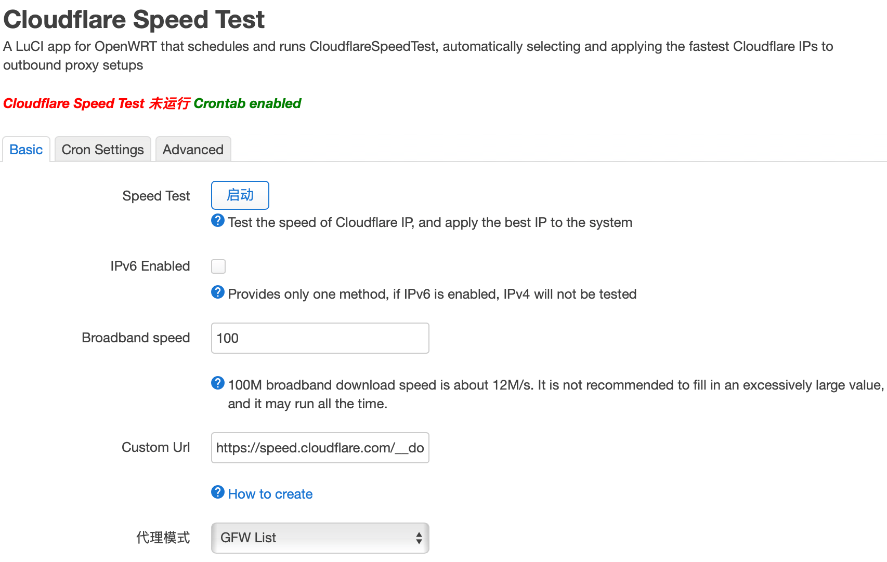
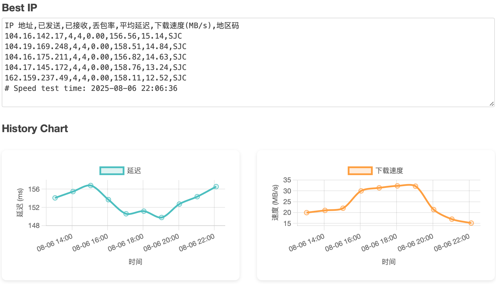

# luci-app-passwall-speedtest

[](https://github.com/urbanescavenger/luci-app-passwall-speedtest/actions/workflows/build.yml)
[](https://github.com/urbanescavenger/luci-app-passwall-speedtest/releases)

[English](README.md)

**luci-app-passwall-speedtest** 是一个用于 OpenWrt 的 LuCI 插件：**通过你已有的 [PassWall](https://github.com/xiaorouji/openwrt-passwall) 节点**优选 Cloudflare IP。它把每个候选 IP 临时写进一个 passwall 节点的 `address`，用 passwall 拉起本地 SOCKS：先用 `curl -I` 取 `time_pretransfer` 对全部候选做延迟初筛，再对每个 worker 延迟最优的 N 个 IP 经同一条节点链路**真实下载固定大小文件**、按实测吞吐（MB/s）选出最终最优；测完把最优 IP 写回 passwall 节点及其它集成。

> 这是对原 `luci-app-cloudflarespeedtest` 的重构：**已移除独立 CloudflareSpeedTest 二进制的下载与依赖**，测速完全经由 passwall 完成，不再下载或内置任何外部测速二进制。测速分两阶段：便宜的延迟初筛覆盖全部候选，真实下载只测最有希望的少量候选。

## 依赖

*   **PassWall**（`openwrt-passwall`）必须已安装——测速会调用 `/usr/share/passwall/app.sh run_socks`。未安装 passwall 时测速会报错并中止。
*   **curl**（硬依赖），用于延迟探测。
*   至少一个 CF-CDN 前置的 passwall 节点（VLESS / VMess / Trojan / SS …）。SOCKS 类型的 passwall 节点不能用作测速节点（其 `address` 本身就是 SOCKS 服务器）。

## 主要特性

*   **走节点测速**：经你的 passwall 节点链路探测候选 Cloudflare IP——选出的是「从你代理出口看」最优的 CF IP。
*   **延迟初筛 + 真实下载实测**：先对全部候选测延迟（便宜、覆盖广），再对每个 worker 延迟最优的前 N 个 IP（默认 5 个，最多 5 个）经同一节点链路下载固定大小文件，用 curl 的 `speed_download` 换算 MB/s。最终按实测下载速度选最优；下载失败的 IP 剔除；若全部下载失败（如测试 URL 经该节点不可达）则回退到延迟排序，不丢延迟阶段成果。每个 IP 使用独立的 SOCKS 配置，下载前会校验 `/tmp/etc/passwall/<flag>.json` 里的出站地址确实是该候选 IP，避免测到与候选 IP 无关的速度。多个 worker 的下载测试**全局串行**执行——否则并发下载会互抢路由器 WAN 带宽，各 IP 的速度没有可比性。迭代模式下下载实测是收敛结束后的额外阶段，不计入 `iterate_minutes`。
*   **复测现有最优 IP**：主设置页新增「复测现有最优 IP」按钮（CLI：`passwall-speedtest.sh retest`）——**不重新下载在线 IP 列表**，只取当前 `result.csv` 中该节点的行 + 节点当前 `address`，做一轮延迟测速 + 下载实测后照常写回。适合定时跑完后快速确认现有最优是否仍然可用、或在不拉取上万条候选的情况下重新排序。
*   **多线程 worker**：在「第三方设置」里选的 passwall 节点作为并行 worker——每个 worker 经自己的链路测全部候选 IP、各写各的最优 IP；并发上限由 `node_test_threads` 控制。
*   **多探测 fail-fast**：每个 IP 探测 `node_test_probes` 次；任意一次失败该 IP 立即丢弃。只有全部探测都成功的 IP 才保留，确保结果稳定。
*   **限时迭代测速**：开启 `iterate_enabled` 后进入计时模式——每个待测节点跑**独立的收敛循环**直到 `iterate_minutes` 分钟：第 1 遍测完自己的候选后，每遍只测上一遍通过的 IP，候选池逐遍收敛到最稳定、延迟最低的 IP；运行期间不写 result.csv、不写回 passwall。节点候选收敛到 **≤3 个**即保存结果提前结束，不必等到计时结束；结束时日志打出各节点最终轮的完整测速结果，随后一次性写回各节点最优。
*   **应用到代理插件**：最优 IP 自动写回 ssr / passwall / passwall2 / bypass / vssr 节点，以及 HOST / MosDNS / astra-dns / 阿里云 DDNS。
*   **可视化图表**：延迟历史趋势图；悬停/点击数据点显示该节点的最优 IP、延迟与实测下载速度（未做下载实测时只显示延迟）。
*   **优化的界面与日志**：重新设计的状态展示；逐 IP 日志如 `进度: 走节点测速 [节点] 5/30 (16%) - 1.2.3.4 延迟 87ms 丢包 0.00 [保留]`。
*   **中途停止不丢结果**：中途停止会触发 trap 清理 SOCKS、恢复节点 address，若无新结果则保留上一次结果。**用户手动停止第一轮时，已通过延迟的 IP 仍会完成下载实测**（每 worker 最多 5 个，多 worker 串行）后再写回；只有「首个 worker 已完成、其余自动提前停止」的情况才跳过其余 worker 的下载。
*   **丰富的应用集成**：优选 IP 可自动应用到 SSR+ / Passwall / PassWall2 / Bypass / Vssr / HOST / MosDNS / astra-dns / 阿里云 DDNS。

## 界面页面

插件在 LuCI → 服务 → PassWall Speed Test 下提供三个页面：

*   **主设置页（Plugin Settings）**：包含「基本 / 计划」两个 Tab，提供 Start/Stop 测速按钮、3 秒轮询的状态条、Best IP 只读区，以及延迟历史折线图。
*   **第三方集成页（Third Party Settings）**：按本机已安装的代理软件按需显示对应 Tab；此处选中的 passwall 节点同时作为多线程 worker。
*   **日志页（Logs）**：增量拉取测速日志，可勾选每 5 秒自动刷新。

## 测速参数

*   **IP 列表来源**：内置 IPv4 / IPv6 列表或自定义 IP 文件，可选「扫描每个 /24 中的全部 IP」。
*   **延迟上限 / 下限 / 丢包率上限**（`tl` / `tll` / `tlr`）：丢弃超出阈值的候选 IP（单位：ms / ms / 0–1）。
*   **用于测速的 passwall 节点**：未选 passwall worker 时的单节点回退。
*   **探测 URL**：经节点本地 SOCKS 探测的 URL（HTTP HEAD），默认 Google `generate_204`。
*   **最大测速 IP 数**：每个 worker 测试的候选 IP 数上限。
*   **探测超时**：每个 IP 的 curl `--max-time`（秒）。
*   **每 IP 探测次数**：每个 IP 的 curl 探测次数（全部成功才保留）。
*   **最大并发 worker**：多节点模式的并发上限（0 = 全部）。
*   **真实下载测速**（`download_test_enabled`，默认开）：延迟初筛后对少量候选实测下载吞吐。
*   **每 worker 下载测速候选数**（`download_test_count`，默认 5，最多 5）：只测每个 worker 延迟最优的前 N 个 IP。注意这会真实消耗代理流量：默认 URL 为 10 MB，每 worker 最多约 50 MB，多 worker 串行累加。
*   **下载测速 URL**（`download_test_url`）：经节点本地 SOCKS 下载的固定大小文件，默认 Cloudflare `speed.cloudflare.com/__down?bytes=10000000`（10 MB）。响应必须是 HTTP 2xx 且至少收到 16 KB。
*   **下载测速单 IP 时限**（`download_test_time`，默认 10s）：每个 IP 的 curl `--max-time`；被时限截断的部分下载仍按已下载字节计算平均速度。
*   **限时迭代测速 / 迭代测速时长**：开启后进入计时模式，每个待测节点独立循环收敛（每遍只测上一遍通过的 IP），到点取剩余最优写回；迭代收敛结束后同样对最终通过集中延迟最优的前 N 个 IP 做下载实测。

## 优选 IP 的应用方式

测速完成后：

*   每个 passwall worker 节点会写回各自的最优 IP 到 `passwall.<节点>.address`。有下载实测时「最优」= 实测吞吐最高（下载失败的行不参与），未启用或全部失败时退回延迟最低。
*   全局最优 IP（`result.csv` 首行，下载测试成功时即全局吞吐最高）自动写入：HOST（`/etc/hosts`）、MosDNS、astra-dns、阿里云 DDNS，以及 ssr / passwall / passwall2 / bypass / vssr 节点的 `server`/`address` 字段。

> 注：插件不修改 `ip route`。优选 IP 仅通过 hosts / DNS / 代理节点生效。

## 定时任务

内置 cron 调度，支持按 1~24 小时间隔运行，或填写自定义 cron 表达式。`init.d` 脚本以幂等方式按需更新 crontab，不会重复写入。

每次整跑在入口持有一把单实例锁：同一时刻只允许一次完整运行，重叠触发（定时任务重叠、页面连点、SSH 手敲）会被**跳过并记一行日志**，不会两套 worker 去抢同一批 passwall 节点、互删中间状态。锁的持有者被 kill -9 / 断电带走时留下的残留锁，会在下次运行时自动接管。自定义 cron 注意分钟字段别写 `*`（`* 19 * * 4` 是「周四 19 点内每分钟一次」，要一次请写 `0 19 * * 4`）。

## 结果与历史

测速结果保存在 `/tmp/passwall-speedtest/result.csv`，滚动保留 10 个历史版本；Best IP 区按节点分组全量展示。第 6 列 `下载速度(MB/s)` 为真实下载实测值——只对每个 worker 延迟最优的前 N 个 IP 填写，未测到或未启用下载测速的行保持 `0.00`。延迟图表取持久历史绘制。

运行日志保存在 `/tmp/passwall-speedtest.log`，每次运行开始时把上次日志滚动归档为 `.log.1` ~ `.log.5`（最近 5 次，`/tmp` 内存盘重启即清、不写 flash）。此外每次运行结束时把本次完整日志**覆盖**到 `/etc/config/passwall-speedtest.log`（与 UCI 配置文件同目录，持久保存、重启不丢，只保留最近一次运行）。日志页整行显示，含 `[节点备注名]` 与 `[保留]/[丢弃]` 标签，可直接按节点核对迭代轮次。

## 安装与使用

1.  从 [Releases](https://github.com/urbanescavenger/luci-app-passwall-speedtest/releases) 页面下载最新的 `.ipk` 或 `.apk` 文件。
2.  上传到路由器并安装：
    ```bash
    opkg install luci-app-passwall-speedtest_*.ipk
    ```
    *注：如果安装时提示缺少依赖，请先更新 opkg 源 (`opkg update`)。*
3.  进入 LuCI 界面 → 服务 → PassWall Speed Test 进行配置。
    > 从旧版 `luci-app-cloudflarespeedtest` 升级：UCI 配置已改名为 `passwall-speedtest`，旧设置**不会**自动迁移，请在 LuCI 页面重新配置；旧 `/etc/config/cloudflarespeedtest` 可自行删除。

## 截图




## 编译

```bash
# 仅编译软件包
make package/luci-app-passwall-speedtest/compile V=99

# 编译完整固件
make menuconfig
#choose LuCI ---> 3. Applications  ---> <*> luci-app-passwall-speedtest..... for LuCI ----> save
make V=99
```

## 致谢

*   [openwrt-passwall](https://github.com/xiaorouji/openwrt-passwall)
*   [CloudflareSpeedTest](https://github.com/XIU2/CloudflareSpeedTest)（沿用其 IP 列表格式）
*   [mingxiaoyu/luci-app-cloudflarespeedtest](https://github.com/mingxiaoyu/luci-app-cloudflarespeedtest)