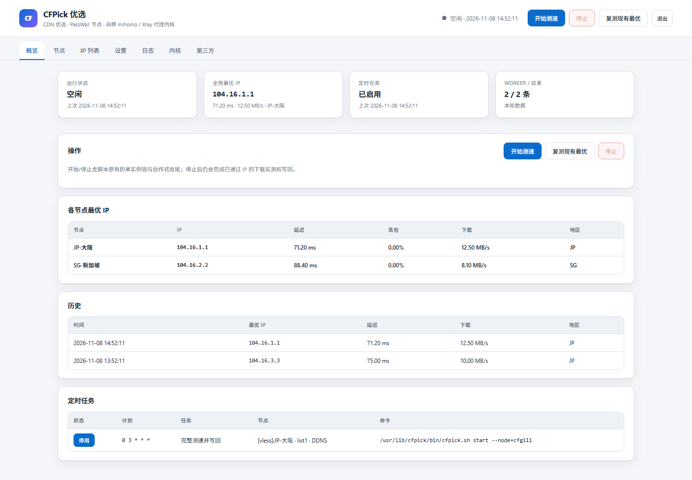

# CFPick

[](https://github.com/urbanescavenger/CFPick/actions/workflows/build.yml)
[](https://github.com/urbanescavenger/CFPick/releases)

[English](README.en.md)

**CFPick 是一个 Cloudflare CDN 优选 IP 工具：用真实的代理内核在本机实测，从 Cloudflare 真实的 CDN 边缘节点中挑出对你这条线路最快的 IP。**

*   **候选可以来自最新的在线优选 IP 列表**：选择在线 CM 源后，每轮测速前都会实时拉取最新列表（`IP:PORT#国家码`，可按国家和端口筛选，URL 可自定义）；也可改用内置 IPv4 / IPv6 列表或自定义 IP 文件。列表只是候选，不是最终结论。
*   **用真实内核、真实链路测速**：每个候选 IP 都临时写进节点配置，由本机 mihomo / Xray-core 内核，或你已有的 [PassWall](https://github.com/xiaorouji/openwrt-passwall) 节点拉起本地 SOCKS，对候选 IP 发起真实连接并实测。
*   **选的是本地最优，而不是列表排名**：先对全部候选测延迟，再对延迟最优的若干 IP 真实下载固定大小文件测吞吐；最终选哪个 IP 取决于你本机的实际网络，而不是别人测出来的排序。

测速流程：把每个候选 IP 临时写进一个节点（或交给本机内核），用本地 SOCKS 发起 `curl -I` 取 `time_pretransfer` 对全部候选做延迟初筛；再对每个 worker 延迟最优的 N 个 IP 经同一条链路**真实下载固定大小文件**，按实测吞吐（MB/s）选出最终最优，最后写回节点及其它集成。

CFPick 提供两种部署方式：

*   **OpenWrt LuCI 插件**（`luci-app-cfpick`）：经你已有的 PassWall 节点或本机内核完成上述测速，把最优 IP 写回代理节点和 DNS 集成。
*   **Debian / Ubuntu 脚本版**（[`debian/`](debian/README.md)）：不依赖 OpenWrt 和 PassWall，自带两个可切换、可独立升级的代理内核、Python 标准库引擎与 Web 面板。

> **改名说明**：项目原名 `luci-app-cloudflarespeedtest`，后改为 `luci-app-passwall-speedtest`；从 **1.0.0** 起统一更名为 **CFPick**。包名 `luci-app-cfpick`，UCI 配置 `/etc/config/cfpick`，CLI `cfpick`。旧配置不会自动迁移，升级后请在 LuCI 重新配置。

## 依赖

*   **PassWall**（`openwrt-passwall`）必须已安装——测速会调用 `/usr/share/passwall/app.sh run_socks`。未安装 passwall 时测速会报错并中止。
*   **curl**（硬依赖），用于延迟探测。
*   至少一个 CF-CDN 前置的 passwall 节点（VLESS / VMess / Trojan / SS …）。SOCKS 类型的 passwall 节点不能用作测速节点（其 `address` 本身就是 SOCKS 服务器）。

## 主要特性

*   **走节点测速**：经你的 passwall 节点链路探测候选 Cloudflare IP——选出的是「从你代理出口看」最优的 CF IP。
*   **延迟初筛 + 真实下载实测**：先对全部候选测延迟（便宜、覆盖广），**等所有 worker 停止探测后**，再由主进程对每个 worker 延迟最优的前 N 个 IP（默认 5 个，最多 10 个）经同一节点链路**逐节点、逐 IP 串行**下载固定大小文件，用 curl 的 `speed_download` 换算 MB/s。最终按实测下载速度选最优；下载失败的 IP 剔除；若全部下载失败（如测试 URL 经该节点不可达），会等其他 worker 的下载全部结束后，按复测候选（当前 `result.csv` + 节点 address）再完整测一轮，仍全失败才回退到延迟排序，不丢延迟阶段成果。每个 IP 使用独立的 SOCKS 配置，下载前会校验 `/tmp/etc/passwall/<flag>.json` 里的出站地址确实是该候选 IP，避免测到与候选 IP 无关的速度。下载与延迟探测不重叠——否则仍在探测的 worker 会与下载互抢路由器 WAN 带宽，各 IP 的速度没有可比性。**快速死亡**：起测 5 秒内下载不足 1 MB 的候选会被立即中止并判失败（curl `--speed-limit`/`--speed-time`），死 IP / 爬行 IP 不再白等满单 IP 时限。迭代模式下下载实测是收敛结束后的额外阶段，不计入 `iterate_minutes`。
*   **复测现有最优 IP**：主设置页新增「复测现有最优 IP」按钮（CLI：`/usr/lib/cfpick/bin/cfpick.sh retest`）——**不重新下载在线 IP 列表**，只取当前 `result.csv` 中该节点的行 + 节点当前 `address`，DDNS 节点再解析其域名当前指向的 IP 作为候选。候选按 passwall section ID 匹配（旧结果没有 ID 列时回退节点名），改 remarks 不会再把节点认丢。候选来源与调度方式相互独立：默认做一轮延迟测试 + 下载实测；若同时开启「限时迭代测速」，同一批候选会进入各节点的收敛循环直到 `iterate_minutes` 结束，每轮剔除未通过的 IP。结束后照常写回。适合定时跑完后快速确认现有最优是否仍然可用、或在不拉取上万条候选的情况下重新排序。
*   **多线程 worker**：在「第三方设置」里选的 passwall 节点作为并行 worker——每个 worker 经自己的链路测全部候选 IP、各写各的最优 IP；并发上限由 `node_test_threads` 控制。
*   **多探测 fail-fast**：每个 IP 探测 `node_test_probes` 次；任意一次失败该 IP 立即丢弃。只有全部探测都成功的 IP 才保留，确保结果稳定。
*   **成功后监测**：worker 取得有效结果后派生后台监测进程，每 `monitor_interval` 秒（默认 60）复测一次这个成功结果的延迟：普通节点测已写回的 address（即 result.csv 里该 worker 的最优 IP），配置了 DDNS 域名的节点按域名测（先解析，优先测记录里仍指向的最优 IP）。连续 `monitor_failures` 次（默认 3）失败即触发该 worker 的复测；worker 被下一次定时/手动任务占用时监测自动退出让位，任务成功后重新拉起。监测只做轻量 HEAD 探测，不选 IP、不写回、不占下载锁；下载实测期间自动跳过。节点页每个 worker 显示「监测 X ms」徽标，明细见 `/tmp/cfpick.log`。可用 `monitor_enabled=0` 关闭。
*   **限时迭代测速**：开启 `iterate_enabled` 后进入计时模式——每个待测节点跑**独立的收敛循环**直到 `iterate_minutes` 分钟：第 1 遍测完自己的候选后，每遍只测上一遍通过的 IP，候选池逐遍收敛到最稳定、延迟最低的 IP；运行期间不写 result.csv、不写回 passwall。节点候选收敛到 **≤「迭代收敛阈值」**（`iterate_converge_count`，默认 5、最多 100）即保存结果提前结束，该阈值与下载实测候选数 `download_test_count` 相互独立；不必等到计时结束；结束时日志打出各节点最终轮的完整测速结果，随后一次性写回各节点最优。
*   **应用到代理插件**：最优 IP 自动写回 ssr / passwall / passwall2 / bypass / vssr 节点，以及 HOST / MosDNS / astra-dns / 阿里云 DDNS。
*   **优化的界面与日志**：重新设计的状态展示；逐 IP 日志如 `进度: 走节点测速 [节点] 5/30 (16%) - 1.2.3.4 延迟 87ms 丢包 0.00 [保留]`。
*   **中途停止不丢结果**：中途停止会触发 trap 清理 SOCKS、恢复节点 address，若无新结果则保留上一次结果。**用户手动停止第一轮时，已通过延迟的 IP 仍会完成下载实测**（每 worker 最多 `download_test_count` 个（上限 10）；所有 worker 停止探测后逐节点逐 IP 串行）后再写回；「首个 worker 已完成、其余自动提前停止」也一样，不再跳过其余 worker 的下载。
*   **丰富的应用集成**：优选 IP 可自动应用到 SSR+ / Passwall / PassWall2 / Bypass / Vssr / HOST / MosDNS / astra-dns / 阿里云 DDNS。
*   **独立内核测速**：统一测速可切换到本机 mihomo / Xray-core 内核（同一套节点、IP 列表和参数），内核可独立安装/升级；启用后不再依赖 `run_socks`，也不需要改写 PassWall 节点。

## 界面页面

插件在 LuCI → 服务 → CFPick 下只有两个入口，和 Lucky 的布局一致：

*   **操作台（Console）**：显示测速运行状态、Web 操作台地址，以及「打开 Web 操作台」按钮；实际操作都在独立操作台里完成，「内核」页签也在操作台内。
*   **设置（Settings）**：Web 操作台入口配置（启用、端口、监听地址、用户名、会话有效期、打开操作台、重置密码），以及「在线更新」：页面显示当前安装版本，点「检查更新」校验 GitHub 最新 Release，只有存在更新时「在线更新」按钮才可用；测速运行中拒绝更新，更新完成后刷新页面即可。所有测速设置和操作仍在独立操作台的页签里。

## 独立 Web 操作台

独立操作台（`cfpick-web`）在单独端口运行，有自己的登录和管理界面；LuCI 的「设置」只保留操作台入口配置，所有测速设置和操作都在操作台里。

### 启用

1. LuCI → 服务 → CFPick → **设置 → Web 操作台**；
2. 勾选「启用独立操作台」，设置端口（默认 **17544**，避开 Lucky 常用的 17543）、监听地址和用户名；
3. 保存并应用，服务会自动启动；
4. 浏览器打开 `http://<路由器IP>:17544/`，首次会要求创建管理员密码（至少 6 位）。

密码只以加盐 SHA-256 哈希保存在 UCI（`cfpick.global.web_password`），不保存明文；会话 Cookie 为 `HttpOnly` + `SameSite=Strict`，写操作还要求自定义请求头，防止 CSRF。

### 操作台页签

*   **概览**：运行状态、全局最优 IP、定时任务、Worker / 结果四张状态卡；操作卡（开始 / 停止 / 复测）；各节点最优 IP 表（同一节点首次出现的行即该节点最优）；最近 12 次历史；定时任务（可直接启用/停用）。
*   **节点**：单节点/稳定节点，以及 worker 表（每个 PassWall 节点一行，并指派 CM IP 列表）。
*   **IP 列表**：五个 CM 源列表的启用、名称、国家码、端口和各自的延迟上限（0 = 跟随全局；不同地区可用不同标准）。
*   **设置**：IP 来源、延迟/丢包阈值、探测参数、下载实测、限时迭代、五段 cron、DDNS（含预览/立即写入）、内核与 Web、操作台账号。
*   **日志**：两个窗口——运行日志（自动滚动、每 2 秒刷新、重新加载、下载）与任务日志（每次测速的结果描述：成功/失败/异常数量、各节点本次更新用的 IP、写回方式、延迟与速度，以及下载全部失败加测等特殊事件）。
*   **内核**：独立内核开关与选择、mihomo / Xray-core 安装升级卡片、内核更新日志、程序在线更新。
*   **第三方**：SSR+ / PassWall / PassWall2 / Bypass / Vssr / HOST / 阿里云 DNS / MosDNS / astra-dns 的写回配置。

操作台与 Debian 版（`debian/web`）使用同一套界面与交互，差异只有：节点来源（OpenWrt 用 PassWall 节点，Debian 用分享链接）、鉴权方式（操作台账号 vs Web 令牌），以及 OpenWrt 版多一个「第三方」写回页签。

操作台内部调用同一套 `api_*` 管理 API，因此和 LuCI 页面看到的数据完全一致。

### 账号与安全

*   修改密码：操作台「设置 → 操作台账号」，修改后需要重新登录。
*   忘记密码：SSH 执行
    ```sh
    uci delete cfpick.global.web_password
    uci commit cfpick
    /etc/init.d/cfpick-web restart
    ```
    然后重新打开操作台创建密码。
*   操作台默认只建议在局域网使用（明文 HTTP）；远程访问请走 VPN 或带 TLS 的反向代理，不要把 17544 直接暴露到公网。
*   服务脚本：`/etc/init.d/cfpick-web`；端口、监听地址、用户名由 UCI 的 `web_port` / `web_bind` / `web_user` 控制，保存配置会触发服务重载。

## 独立内核模式（统一测速的可选项）

可以在操作台的 **「内核」** 页签里，把**统一测速**切换到本机 mihomo / Xray-core：

*   **启用开关**：勾选「启用独立内核」并保存。启用后，「开始测速」的每个 worker 用本机内核拉起候选 IP 的本地 SOCKS（`cfpick core start`），不再调用 PassWall 的 `run_socks`；关闭则完全保持原来的 PassWall 流程。
*   **同一套配置**：节点仍是「节点」页里的 PassWall worker，IP 列表、探测/下载参数、定时任务都不变；不需要第二套节点或分享链接。
*   **双内核 + 自助升级**：mihomo 与 Xray-core 二选一；页签按内核各显示一张卡片（版本、路径、来源、当前使用状态），可填版本标签后单独「安装/升级」到 `/etc/cfpick/state/core`（独立于 PassWall 的内核），也可继续复用系统 `/usr/bin/mihomo`、`/usr/bin/xray`。
*   **不碰 PassWall**：独立模式下测速期间不改写节点 `address`、不切换全局节点；内核出站带 `mark 255`，命中 PassWall OUTPUT 链的 `meta mark 255 return`，保持「本地 SOCKS → 被测节点」单层，**不需要修改 PassWall 配置**。节点类型与所选内核不兼容（如 ss/hysteria2、带 plugin 的 SS、VMess xhttp 选 mihomo 等）时，该节点自动回退 PassWall `run_socks`，并在日志里说明。
*   **写回**：测完仍按原逻辑把各 worker 的最优 IP 写回 PassWall 节点；如果节点配置了 DDNS 域名，则该节点只写 DNS、不回写（见下）。
*   **CLI**：
    ```sh
    cfpick cores
    cfpick update-core --type xray|mihomo|all
    cfpick core start --node <id> --ip <candidate> --port <socks> --core xray --flag <flag>
    cfpick core stop --flag <flag>
    ```
*   **依赖**：`python3-light`、`python3-urllib`、`python3-codecs`、`python3-openssl`、`python3-email`、`curl`、`ca-bundle`（由 ipk 自动安装）。

## 按节点 DDNS（Cloudflare）

*   在操作台 **设置 → DDNS（Cloudflare 优选 IP）** 卡里填写 API Token（可选 Zone ID / Zone 名称、TTL、每节点写入 IP 数、是否走 Cloudflare 代理），勾选启用；「预览」可先看计划写入的域名与 IP，「立即写入」不等测速直接写当前结果。
*   在 **节点** 页 worker 表的 **DDNS 域名** 列填该节点的域名。
*   测速结束后：填了域名的 worker 把最优 IP 写入该域名的 A/AAAA 记录，**不再写回 PassWall 节点**；没填域名的 worker 照旧写回。
*   域名需属于同一个 Cloudflare Zone；留空 Zone 时按域名自动查找。DDNS 失败只记日志，不影响测速结果。

## 管理 API

rpcd 对象 `cfpick` 同时提供两套方法：

*   **旧方法**（`status` / `start` / `start_retest` / `stop` / `get_log` / `get_history` / `get_best_result` / `list_nodes`）保持原有返回结构，已有页面和脚本不受影响。
*   **`api_*` 稳定接口**：统一返回信封，异常也会变成正常响应，便于外部脚本消费：

```json
{ "ok": true,  "data": { }, "ts": 1700000000 }
{ "ok": false, "error": "message", "ts": 1700000000 }
```

| 方法 | 权限 | 参数 | 说明 |
| --- | --- | --- | --- |
| `api_ping` | read | — | 健康检查与 API 版本 |
| `api_status` | read | — | 运行状态、PID、模式、阶段、耗时、cron、worker 数与全局最优 |
| `api_results` | read | `limit`（0 = 全部） | `result.csv` 的结构化结果 |
| `api_history` | read | — | 持久历史（与旧 `get_history` 相同） |
| `api_tasklog` | read | — | 任务日志：每次测速的结果描述（成功/失败/异常数量）、各节点更新 IP / 写回方式 / 延迟 / 速度，以及特殊处理（下载全部失败加测、候选不足重新拉取） |
| `api_nodes` | read | — | 本机各代理软件的节点列表 |
| `api_log` | read | `pos` | 增量日志，`pos` 为上次返回的位置 |
| `api_tasks` | read | — | 只列出与本插件相关的 crontab 任务（`/etc/crontabs/root`、`/etc/crontab`），含计划、命令与启用状态 |
| `api_task_save` | write | `source` `line` `schedule` `enabled` `mode` `nodes` | 修改相关任务的计划、类型、节点或启用/停用（普通 crontab 行） |
| `api_task_delete` | write | `source` `line` | 删除相关任务（普通 crontab 行） |
| `api_task_add` | write | `source` `schedule` `command` | 添加相关任务（命令必须指向本插件） |
| `api_run_start` | write | — | 开始一轮完整测速 |
| `api_run_retest` | write | — | 复测现有最优 IP |
| `api_run_stop` | write | — | 请求停止（协作式，完成收尾后退出） |

示例：

```sh
ubus call cfpick api_status
ubus call cfpick api_results '{"limit":500}'
ubus call cfpick api_tasks
```

通过 LuCI/rpcd 会话访问的外部应用需要在 ACL 中获得对应方法的 read/write 权限；以 root 直接执行 `ubus call` 不受 ACL 限制。本插件自带的 ACL 已包含全部 `api_*` 方法。

> 首次安装或升级本版本后，如果管理页提示 `Request failed` 或看不到 `api_*` 方法，请执行 `/etc/init.d/rpcd restart`（或重启路由器）让 rpcd 重新加载 ucode 与 ACL。

## 测速参数

*   **IP 列表来源**：内置 IPv4 / IPv6 列表或自定义 IP 文件，可选「扫描每个 /24 中的全部 IP」。
*   **延迟上限 / 下限 / 丢包率上限**（`tl` / `tll` / `tlr`）：丢弃超出阈值的候选 IP（单位：ms / ms / 0–1）。
*   **用于测速的 passwall 节点**：未选 passwall worker 时的单节点回退。
*   **探测 URL**：经节点本地 SOCKS 探测的 URL（HTTP HEAD），默认 Google `generate_204`。
*   **最大测速 IP 数**：每个 worker 测试的候选 IP 数上限。
*   **探测超时**：每个 IP 的 curl `--max-time`（秒）。
*   **每 IP 探测次数**：每个 IP 的 curl 探测次数（全部成功才保留）。
*   **最大并发 worker**：多节点模式的并发上限（0 = 全部）。
*   **真实下载测速**（`download_test_enabled`，默认开）：延迟初筛后对少量候选实测下载吞吐。
*   **每 worker 下载测速候选数**（`download_test_count`，默认 5，最多 10）：只测每个 worker 延迟最优的前 N 个 IP。注意这会真实消耗代理流量：默认 URL 为 10 MB，每 worker 最多约 100 MB，多 worker 串行累加。
*   **下载测速 URL**（`download_test_url`）：经节点本地 SOCKS 下载的固定大小文件，默认 Cloudflare `speed.cloudflare.com/__down?bytes=10000000`（10 MB）。响应必须是 HTTP 2xx 且至少收到 16 KB。
*   **下载测速单 IP 时限**（`download_test_time`，默认 10s）：每个 IP 的 curl `--max-time`；被时限截断的部分下载仍按已下载字节计算平均速度。
*   **限时迭代测速 / 迭代测速时长**：开启后进入计时模式，每个待测节点独立循环收敛（每遍只测上一遍通过的 IP），到点取剩余最优写回；迭代收敛结束后同样对最终通过集中延迟最优的前 N 个 IP 做下载实测。

## 优选 IP 的应用方式

测速完成后：

*   每个 passwall worker 节点会写回各自的最优 IP 到 `passwall.<节点>.address`。有下载实测时「最优」= 实测吞吐最高（下载失败的行不参与），未启用或全部失败时退回延迟最低。
*   全局最优 IP（`result.csv` 首行，下载测试成功时即全局吞吐最高）自动写入：HOST（`/etc/hosts`）、MosDNS、astra-dns、阿里云 DDNS，以及 ssr / passwall / passwall2 / bypass / vssr 节点的 `server`/`address` 字段。

> 注：插件不修改 `ip route`。优选 IP 仅通过 hosts / DNS / 代理节点生效。

## 定时任务

定时任务就是普通的 crontab 行（`/etc/crontabs/root`），由操作台维护；`init.d` 不再根据 UCI 生成或重写任何任务，因此没有单独的“主任务”概念。`start` / `retest` / `test` / `replace` 都只是普通任务类型。

操作台「概览 → 定时任务」显示与本插件相关的 crontab 行。所有任务一视同仁：可改计划、切换类型、勾选 worker、启用/停用、删除。停用不会删除该行，而是加上 `# [cfpick-disabled]` 前缀注释，随时可以恢复。添加与已有行完全相同的任务会被拒绝，并提示直接修改列表里的那一行。旧的 UCI `enabled` / `custom_cron` 字段只作为兼容保留，不再产生任务。

任务可以勾选只跑部分 worker（只列「节点」页已配置的 worker），命令会写成
`/usr/lib/cfpick/bin/cfpick.sh retest --node=<passwall section> ...`；
**不勾选 = 全部待测节点**（与不带 `--node` 等价）。在「节点」页删除 worker 并保存配置时，
本插件会同步从所有任务里移除该节点；如果某个任务因此不再剩任何节点，会直接删除该任务，
不会悄悄变成“跑全部节点”。

并发按 worker 区分：同一个 worker 同时只允许一个任务；两个任务有重叠 worker 时，后启动
的任务**只跳过被占用的 worker**，任务里其余 worker 继续执行（一个都没抢到才整任务跳过）。
下载实测和写回阶段全局串行（后到者排队等待），并且**下载期间其他任务的探测会暂停**，
等对方下载完自动继续，避免互相抢带宽把速度测偏。停止按钮只停止各 worker 的**探测**：
已经跑完探测的任务仍会按它自己的候选/下载列表排队完成下载和写回，不会被停止请求丢掉。
每次提交只把本次 worker 的行合并进 `result.csv`，写回/回滚也只改本次 worker 的 `address`，
不会动别的任务正在测的节点。

整跑入口按 worker 加锁：同一 worker 同时只允许一个任务；重叠 worker 的后来者只跳过冲突的那几个，其余继续。锁的持有者被 kill -9 / 断电带走时留下的残留锁（worker 锁、下载锁、运行登记），会在下次运行时按 PID 判死并自动接管。自定义 cron 注意分钟字段别写 `*`（`* 19 * * 4` 是「周四 19 点内每分钟一次」，要一次请写 `0 19 * * 4`）。

## 结果与历史

测速结果保存在 `/tmp/cfpick/result.csv`，滚动保留 10 个历史版本；Best IP 区按节点分组全量展示。第 6 列 `下载速度(MB/s)` 为真实下载实测值——只对每个 worker 延迟最优的前 N 个 IP 填写，未测到或未启用下载测速的行保持 `0.00`。末两列为节点名称（remarks，展示用）和 passwall section ID（复测/历史/DDNS 的稳定主键）。概览的「历史」表取持久历史绘制。

运行日志保存在 `/tmp/cfpick.log`，每次运行开始时把上次日志滚动归档为 `.log.1` ~ `.log.5`（最近 5 次，`/tmp` 内存盘重启即清、不写 flash）。此外每次运行结束时把本次完整日志**覆盖**到 `/etc/config/cfpick.log`（与 UCI 配置文件同目录，持久保存、重启不丢，只保留最近一次运行）。日志页整行显示，含 `[节点备注名]` 与 `[保留]/[丢弃]` 标签，可直接按节点核对迭代轮次。

## 安装与使用

1.  从 [Releases](https://github.com/urbanescavenger/CFPick/releases) 页面下载最新的 `.ipk` 或 `.apk` 文件。
2.  上传到路由器并安装：
    ```bash
    opkg install luci-app-cfpick_*.ipk
    ```
    *注：如果安装时提示缺少依赖，请先更新 opkg 源 (`opkg update`)。*
3.  进入 LuCI 界面 → 服务 → CFPick 进行配置。
    > **从旧版升级**：包名已改为 `luci-app-cfpick`，UCI 配置改为 `cfpick`，CLI 改为 `cfpick`。旧设置**不会**自动迁移——请先卸载旧包（`opkg remove luci-app-passwall-speedtest` 或 `opkg remove luci-app-cloudflarespeedtest`），安装新包后重新配置；旧 `/etc/config/passwall-speedtest` 可自行删除。

## 截图



## 编译

```bash
# 仅编译软件包
make package/luci-app-cfpick/compile V=99

# 编译完整固件
make menuconfig
#choose LuCI ---> 3. Applications  ---> <*> luci-app-cfpick..... for LuCI ----> save
make V=99
```

## Debian / Ubuntu 独立版

主分支提供一套不依赖 OpenWrt/PassWall 的独立实现，位于 [`debian/`](debian/README.md)：自带 **mihomo / Xray-core** 两个可切换、可分别升级的代理内核模块（用节点分享链接测速）、Python3 标准库引擎与 Web 可视化页面，结果导出为 CSV/JSON。

一键部署（Debian/Ubuntu）：

```bash
curl -fsSL https://raw.githubusercontent.com/urbanescavenger/CFPick/main/debian/deploy.sh -o /tmp/cfpick-deploy.sh
sudo bash /tmp/cfpick-deploy.sh
rm -f /tmp/cfpick-deploy.sh
```

或手动安装：

```bash
git clone https://github.com/urbanescavenger/CFPick.git
cd CFPick
sudo sh debian/install.sh
```

完整部署、升级、卸载和 Web 访问方式见 [`debian/README.md`](debian/README.md)。

## 致谢

*   [openwrt-passwall](https://github.com/xiaorouji/openwrt-passwall)
*   [CloudflareSpeedTest](https://github.com/XIU2/CloudflareSpeedTest)（沿用其 IP 列表格式）
*   [mingxiaoyu/luci-app-cloudflarespeedtest](https://github.com/mingxiaoyu/luci-app-cloudflarespeedtest)