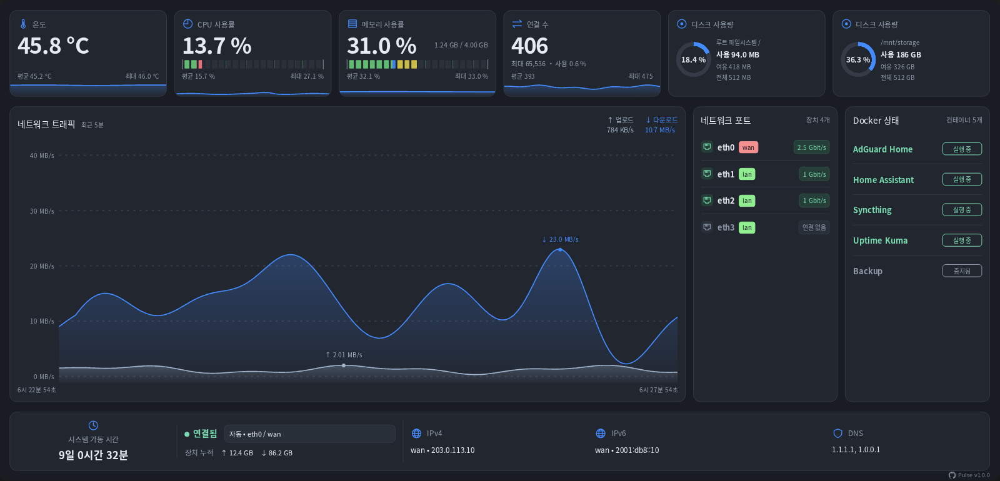

# Pulse

### 시스템 리소스, 네트워크 트래픽, 이더넷 포트 및 컨테이너 상태를 한눈에 보여 주는 경량 OpenWrt LuCI 대시보드입니다.

[English](README.md) · [简体中文](README.zh-CN.md) · [한국어](README.ko.md)

최신 정식 버전 설치:

```sh
uclient-fetch -O /tmp/install-pulse.sh https://raw.githubusercontent.com/w9315273/luci-app-pulse/main/install.sh && sh /tmp/install-pulse.sh
```



## 기능

- 실시간 네트워크 트래픽과 최근 5분 그래프
- CPU, 메모리, 온도, 연결 수 및 디스크 사용량
- 이더넷 링크 상태, 협상된 속도, IP 주소 및 DNS
- Docker 컨테이너 상태(선택 사항)
- 밝은 테마와 어두운 테마, 모바일 레이아웃

> [!NOTE]
> - **수집 주기:** 네트워크 트래픽은 1초마다 수집하며, 시스템 지표와 화면은 2초마다 갱신합니다. 최근 5분 기록은 메모리에 저장됩니다. 페이지를 닫아도 수집은 계속되며, 라우터나 수집 서비스를 다시 시작하면 기록이 초기화됩니다.
> - **인터페이스:** 자동 선택은 WAN을 우선하며, 장치를 직접 선택할 수도 있습니다. 물리 장치는 해당 장치의 전체 트래픽을, 가상 장치는 해당 가상 장치의 트래픽을 표시합니다. 업로드는 TX, 다운로드는 RX이며, LAN 장치를 선택하면 클라이언트 관점과 방향이 반대일 수 있습니다.
> - **장치 누적 트래픽:** 선택한 장치의 카운터 값입니다. 최근 5분으로 제한되지 않으며 일별·월별 통계도 아닙니다. 장치가 다시 생성되거나 카운터가 초기화되면 다시 집계됩니다.
> - **연결 상태:** 링크 상태를 나타내며, 인터넷 연결 가능 여부를 의미하지 않습니다.
> - **조건부 표시:** 온도를 읽을 수 있을 때 온도 카드가 표시됩니다. 디스크 카드는 기본적으로 루트 파일 시스템을 표시하고 추가로 마운트된 디스크를 감지합니다. Docker를 사용할 수 있으면 컨테이너 상태를 읽기 전용으로 표시합니다. Pulse를 사용하기 위해 Docker를 설치할 필요는 없습니다.
