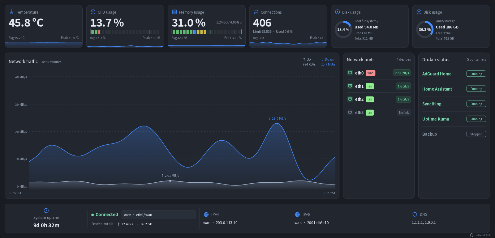

# Pulse

### A lightweight OpenWrt LuCI dashboard for system resources, network traffic, Ethernet ports, and containers.

[English](README.md) · [简体中文](README.zh-CN.md) · [한국어](README.ko.md)

Install the latest release:

```sh
uclient-fetch -O /tmp/install-pulse.sh https://raw.githubusercontent.com/w9315273/luci-app-pulse/main/install.sh && sh /tmp/install-pulse.sh
```



## Features

- Live network traffic with a five-minute chart
- CPU, memory, temperature, connections, and disk usage
- Ethernet link status, negotiated speed, IP addresses, and DNS
- Docker container status (optional)
- Light and dark themes and mobile layout

> [!NOTE]
> - **Sampling:** Network traffic is sampled every second; system metrics and the page update every two seconds. The last five minutes are stored in memory. Collection continues when the page is closed; restarting the router or collector clears the history.
> - **Interfaces:** Automatic selection prioritizes WAN; devices can also be selected manually. A physical device reports its total traffic, while a virtual device reports its own traffic. Upload is TX and download is RX; on LAN devices, these directions may be opposite to the client's perspective.
> - **Device totals:** Values come from the selected device's counters. They are not limited to the last five minutes and are not daily or monthly totals. They reset when the device is recreated or its counters reset.
> - **Connection status:** Indicates link status, not Internet connectivity.
> - **Conditional display:** Temperature appears when a reading is available. Disk cards show the root filesystem and detect additional mounted disks. Docker status is shown when available and is read-only; Docker is not required to use Pulse.
