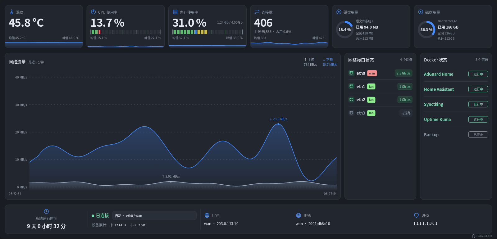

# Pulse

### 轻量级 OpenWrt LuCI 仪表盘，集中展示系统资源、网络流量、网口与容器状态。

[English](README.md) · [简体中文](README.zh-CN.md) · [한국어](README.ko.md)

安装最新正式版：

```sh
uclient-fetch -O /tmp/install-pulse.sh https://raw.githubusercontent.com/w9315273/luci-app-pulse/main/install.sh && sh /tmp/install-pulse.sh
```



## 功能

- 实时网络流量与最近 5 分钟曲线
- CPU、内存、温度、连接数和磁盘用量
- 网口状态、协商速率、IP 地址与 DNS
- Docker 容器状态（可选）
- 明暗主题、移动端布局

> [!NOTE]
> - **采样**：网络每秒采样，系统指标与页面每 2 秒更新。最近 5 分钟历史保存在内存，关闭页面仍持续采集；路由器或采集服务重启后清空。
> - **接口**：自动优先选择 WAN，也可手动选择设备。物理设备统计其总流量，虚拟设备统计对应设备流量；上传为 TX，下载为 RX，选择 LAN 设备时方向可能与终端视角相反。
> - **累计流量**：来自所选设备计数器，不限于最近 5 分钟，也不是每日或每月统计；设备重建或计数器重置后重新累计。
> - **连接状态**：表示链路状态，不代表互联网连通性。
> - **按需显示**：可读取温度时显示温度卡片；磁盘默认展示根文件系统，并检测额外挂载磁盘；Docker 可用时显示容器状态，仅供查看，无需为本插件安装 Docker。
