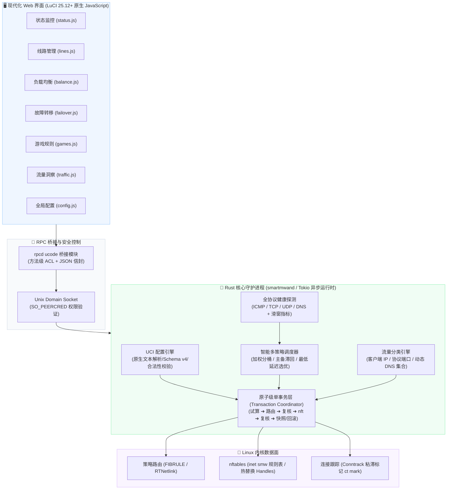

<div align="center">

# 🌐 luci-app-smartmwan

<p align="center">
  <strong>面向 OpenWrt 25.12+ / ImmortalWrt 的下一代多 WAN 策略路由与智能选路系统</strong>
</p>

<p align="center">
  <a href="https://github.com/LianXia233/luci-app-smartmwan/releases/latest"></a>
  <a href="https://openwrt.org/"></a>
  <a href="Cargo.toml"></a>
  <a href="https://netfilter.org/projects/nftables/"></a>
  <a href="https://wiki.alpinelinux.org/wiki/Alpine_Package_Keeper"></a>
  <a href="scripts/no-lua-check.sh"></a>
  <a href="LICENSE"></a>
</p>

<p align="center">
  <a href="#warning">⚠️ 开发声明</a> •
  <a href="#features">✨ 核心特性</a> •
  <a href="#architecture">📊 架构设计</a> •
  <a href="#views">🖥️ 界面一览</a> •
  <a href="#quick-start">🚀 快速上手</a> •
  <a href="#design">🧭 设计原则</a> •
  <a href="#cli">🛠️ 命令行与急救</a> •
  <a href="#faq">❓ 常见问题</a>
</p>

---

</div>

<a id="warning"></a>

> [!CAUTION]
> ### ⚠️ 积极开发中警告 (Under Active Development / Early Preview)
>
> **本项目目前处于早期活跃开发与技术演进阶段（Alpha / WIP），功能不一定完全可用或稳定！**
>
> 1. **稳定性警示**：核心架构与大部分测试已通过，但针对多 WAN 物理链路拔插、特定运营商网络波动、断电重启等复杂边界场景仍在持续实测与调优中；
> 2. **严禁用于生产环境**：**强烈不建议** 直接部署于企业骨干网络、生产环境或对网络可用性有极高要求的关键主路由器上；
> 3. **体验与测试建议**：建议仅在测试路由器、备用机、旁路设备或 WSL / 虚拟化沙盒中尝鲜体验；
> 4. **紧急自救命令**：若在体验过程中发生路由异常或失联，可通过 SSH 终端执行 `smartmwand --reclaim` 一键清空并撤销所有内核规则与表；
> 5. **缺陷反馈**：如遇任何功能异常、UI 报错或内核报错，欢迎提交 [GitHub Issues](https://github.com/LianXia233/luci-app-smartmwan/issues) 附带日志协助排查。

---

## 📖 项目背景

在 OpenWrt 路由器上，经典的多 WAN 工具 `mwan3` 服务了社区多年，但在进入以 **OpenWrt 25.12** 为代表的现代化时代后，其历史架构面临诸多挑战：

- 📦 **包管理器大革新**：OpenWrt 25.12 彻底告别 `opkg`，全面拥抱 **`apk`**；
- 🖼️ **Web 管理层演进**：LuCI 官方弃用 `luasrc/` 架构，全面转向 **ucode 驱动与原生 JavaScript（`L.view`）**；
- 🛡️ **底层防火墙迁移**：内核数据面从旧版 `iptables` 升级为 **`firewall4` + `nftables`**；
- ⚙️ **运维与性能诉求**：传统依赖大量 Shell 脚本轮询与管道拼接的模式，在多连接、大带宽环境下开销高且易出现连接抖动。

**`luci-app-smartmwan`** 应运而生。本项目**专为 OpenWrt 25.12+ / ImmortalWrt 纯净基线设计**，采用 **Rust 异步核心守护进程（`smartmwand`）** + **原生 JavaScript 现代化 Web 视图** + **rpcd ucode 桥接**，彻底摒弃 Lua 运行时，旨在为下一代嵌入式路由提供低开销、秒级响应、原子级可靠的多 WAN 选路方案。

---

<a id="architecture"></a>
## 📊 系统架构设计



---

<a id="features"></a>
## ✨ 核心特性

- 🚫 **绝对零 Lua（Zero-Lua Enforcement）**：
  整个项目无任何 `.lua` 脚本文件，构建流程内嵌 `scripts/no-lua-check.sh` 严苛门禁，杜绝历史包袱，完全适配 25.12+ ucode 架构。
- ⚡ **fwmark 布局契约与单桶热更新**：
  严格规划 `0x5` 魔数与标记掩码（槽位、类别、代际、分桶）。分桶或权重调整时采用 `replace rule handle` 精准原地热替换，已建立连接严格保持原出口，彻底告别分流调整引起的网页重连与游戏掉线。
- 🛡️ **严格单事务与原子级逆序回滚**：
  每次配置变更遵循 `试算 ➔ 路由 ➔ 复核 ➔ nftables ➔ 复核 ➔ 提交快照` 严谨八阶段。路由先于防火墙生效以杜绝黑洞，任何阶段校验未达标立即自动逆序完全撤销，绝不残留半生不熟的脏规则。
- 🔍 **多协议立体探测与抖动抑制**：
  支持 ICMP Ping、TCP SYN、UDP 探测以及 DNS 解析等多维度保活；内置指数平滑移动平均（EWMA）滑窗指标与状态机，结合滞回防抖阈值，杜绝因偶发丢包引发线路来回震荡跳变。
- 🔒 **无 Shell 拼接与原生系统接口**：
  弃用危险且低效的 `sh -c` / `exec` 字符串拼接；系统调用基于白名单与参数数组，底层网络对象通过原生 RTNetlink 二进制协议交互，从根源杜绝命令注入。
- 🎮 **游戏与分流规则解耦**：
  代码核心零硬编码游戏服务器 IP；规则集采用外部驱动与动态 DNS 集合匹配，客户端条件失效时不退化为泛匹配宽规则，安全防御至上。
- 🚨 **一键安全急救与无痕关停**：
  常驻守护进程拦截 `SIGTERM` 并在关停时自主撤销全部内核对象；提供 CLI 级 `smartmwand --reclaim` 一键应急清场，网络故障自救秒级生效。

---

<a id="views"></a>
## 🖥️ 现代化 LuCI Web 界面一览

本插件在 LuCI 控制台「**网络 ➔ 智能多线路**」下提供 7 个模块化功能视图：

| 视图模块 | 文件位置 | 核心功能说明 |
| :--- | :--- | :--- |
| 📊 **状态总览** | `status.js` | 实时呈现各 WAN 线路链路状态机、丢包率、延迟时延抖动与当前出口分配 |
| 🌐 **线路管理** | `lines.js` | 识别多物理/虚拟 WAN 接口，自定义网关、权重、度量值（Metric）与跃点 |
| ⚖️ **负载均衡** | `balance.js` | 动态分桶分配（16/32/64 桶）、哈希种子配置、连接粘滞（Sticky）策略 |
| 🔄 **故障转移** | `failover.js` | 智能主备拓扑、主线路自动/手动回切延迟、连续健康判定阈值门限 |
| 🎮 **游戏选路** | `games.js` | 游戏及关键低延迟服务流量策略，支持动态域名集合（Dynamic Sets）与跨线路择优 |
| 📈 **流量统计** | `traffic.js` | 各出口实时上下行流量吞吐走势图与连接并发数监控 |
| ⚙️ **全局配置** | `config.js` | 总开关控制、Schema 校验、日志审计、运行状态诊断与一键内核清场重置 |

---

<a id="quick-start"></a>
## 🚀 快速上手

### 1. 固件运行环境要求

* **基线系统**：OpenWrt 25.12+ 或 ImmortalWrt（基于 openwrt-25.12 基线分支）
* **支持架构**：`aarch64`（ARM64，如联发科 Filogic 820/830/880、高通 IPQ 等）、`x86_64`
* **系统依赖**：`firewall4`、`nftables`、`luci-base`、`rpcd`、`ucode-mod-socket`

> [!IMPORTANT]
> **内核 Ping Socket 权限配置**：
> 守护进程的健康探测模块依赖非特权 Ping Socket。安装后请确保系统已放通该权限：
> ```sh
> # 立即生效
> sysctl -w net.ipv4.ping_group_range='0 2147483647'
> 
> # 持久化保存
> echo 'net.ipv4.ping_group_range=0 2147483647' >> /etc/sysctl.conf
> ```

### 2. 下载与安装 (.apk)

前往 [Releases 最新发布页](https://github.com/LianXia233/luci-app-smartmwan/releases/latest) 下载构建好的安装包：

```sh
# 复制安装包至路由器 /tmp 目录后执行安装（由于包未内嵌私有签名，需允许 untrusted）
apk add --allow-untrusted /tmp/luci-app-smartmwan-0.6.0-r1.apk
```

### 3. 初次使用与启用

为保证设备网络绝对安全，插件安装后默认状态为：
- `global.enabled = 0`（**默认处于禁用状态**，安装时绝不会直接变更你现有的任何网络与路由策略）。
- 登录路由器 Web 管理页，进入「**网络 ➔ 智能多线路**」；
- 按需检查并调整多 WAN 接口配置，确认无误后勾选“**启用服务**”并点击保存应用。

---

<a id="cli"></a>
## 🛠️ 命令行与应急急救

Rust 守护进程二进制 `smartmwand` 提供了强大的 CLI 排错与自救指令：

```text
用法: smartmwand [OPTIONS]

核心控制选项:
  --check               仅执行 UCI 配置文件静态检查与环境探测，不变更内核
  --reclaim             🚨 紧急清场：彻底清空本插件在内核中注入的所有路由、规则与表
  --restore-last-good   恢复并回退至上一次校验通过的良好配置快照
  --dump-nft            向标准输出转储由当前配置渲染生成的 nftables 规则脚本
  --dump-defaults       向标准输出打印当前 Schema 下的全套默认 UCI 配置
  --dump-include        转储作为 firewall4 扩展注入的 nft 片段
  --capabilities        探测并输出当前系统内核 netlink 与 nftables 的真实能力集
  --print-config        解析并打印格式化后的当前有效运行时配置模型
```

> [!TIP]
> **网络失联急救**：
> 若在测试过程中由于网络参数配置错误导致分流异常，可通过 SSH 终端直接运行：
> ```sh
> smartmwand --reclaim
> /etc/init.d/firewall restart
> ```
> 即可瞬间清除所有策略路由规则并重置防火墙，恢复纯净初始网络。

---

<a id="design"></a>
## 🧭 设计原则

在阅读或参与本项目开发前，请务必了解以下核心设计契约：

1. **真实探测，绝不虚报**：
   `Unsupported` 与 `LocalError`（如本地 Ping 套接字无权限）明确记为本地异常，绝不伪装扣减远端线路的可用性评分；无采样数据时如实呈现“未就绪”。
2. **一次提交，全量或撤销**：
   事务层固定执行 `试算 ➔ 路由 ➔ 复核 ➔ nft ➔ 复核 ➔ 快照` 顺序。路由必须先于 nftables 建立，杜绝产生“流量打标却无出口路由”的短暂黑洞。
3. **不做高频全量重建**：
   内核策略规则总数恒等于启用线路数。分桶调整使用 `replace rule handle`，重排行为受最小切换间隔闸门保护。
4. **规则严谨不妥协**：
   条件书写有误直接报错阻断，绝不吞没异常降级为泛匹配规则；动态集合暂不支持时明确跳过，保障已有流量安全。
5. **零内置游戏 IP 资产**：
   本工程源码内**绝对不内置任何硬编码的游戏服务器地址**，游戏选路模块纯粹充当高性能匹配引擎，具体 IP 资产由规则外部源订阅载入。

---

<a id="development"></a>
## 🛠️ 本地开发与质量门禁

本项目遵循严苛的 Rust 工程化质量标准。在提交任何代码变更前，必须确保以下本地门禁全部通过：

```sh
# 1. 核心库单元测试（395 条单元测试，完全无需 Root 与物理路由器环境）
cargo test --offline --lib

# 2. CLI 门禁测试（4 条验证：--reclaim 配置回落及下发门控）
cargo test --offline --bins

# 3. 跨层集成测试（33 条用例覆盖配置/故障转移/健康度/调度/事务）
cargo test --offline --tests

# 4. Clippy 静态代码检查（0 警告门禁）
cargo clippy --offline --all-targets -- -D warnings

# 5. 代码格式统一性检查
cargo fmt --all -- --check

# 6. Lua 零容忍侵入扫描（扫描仓库内是否存在任何 .lua 文件或引用）
./scripts/no-lua-check.sh
```

---

<a id="faq"></a>
## ❓ 常见问题 (FAQ)

<details>
<summary><strong>Q: 为什么本项目坚决不支持 OpenWrt 21.02 / 23.05 或带有 Lua 的老版本？</strong></summary>

> **架构鸿沟不可调和**：
> OpenWrt 25.12 引入了划时代的根本变革：底座从 `opkg` 变更为 `apk`，LuCI 官方弃用 Lua（`luasrc/` 已不复存在）而全面转用 ucode 原生 JS 驱动。如果为了照顾老版本，必须引入巨量的历史兼容垫片和两套打包机制，这与本项目追求的**轻量、高效、内存安全**理念相违背。
</details>

<details>
<summary><strong>Q: 相比 mwan3，smartmwan 在性能上的主要优势是什么？</strong></summary>

> 1. **常驻异步进程**：由 Rust Tokio 多线程驱动，避免 Shell 脚本频繁被 crond 拉起反复 Fork 多个进程；
> 2. **原地单桶热替换**：权重微调或状态变更仅更新指定 Handle，不需要像 mwan3 一样全量清空并重建 iptables/nftables 规则，消除了重新打标引起的瞬时掉线；
> 3. **内核直接交互**：基于 RTNetlink 二进制协议管理路由，无中间解析层开销。
</details>

<details>
<summary><strong>Q: 为什么安装后 Web 界面没有生效，也没有创建任何路由规则？</strong></summary>

> 为保障用户路由网络安全，**新安装的包默认处于关闭状态（`global.enabled = 0`）**。首次安装后，请进入 LuCI 界面「网络 ➔ 智能多线路」检查各接口状态并手动点击启用。
</details>

---

## 📂 仓库目录结构

```text
luci-app-smartmwan/
├── src/                                  # Rust 后端核心（单一库 + smartmwand 守护进程）
│   ├── lib.rs                            # 架构分层文档、全局错误定义、fwmark 布局契约
│   ├── config/                           # UCI 文本解析/序列化/模型校验与迁移
│   ├── system/                           # RTNetlink、策略路由、nftables 代码生成、接口状态
│   ├── health/                           # 多协议探测器、滑窗指标、链路状态机
│   ├── scheduler/                        # 加权分桶平衡、主备切换、防抖滞回计算
│   ├── rules/                            # 流量分类匹配、动态 DNS 集合驱动
│   ├── transaction.rs                    # 试算/下发/复核/快照/回滚 原子单事务引擎
│   ├── rpc/                              # Unix Socket JSON-RPC 接口与审计日志
│   └── main.rs                           # 守护进程入口、信号处理与异步监督主循环
├── root/                                 # 打包进 apk 的运行时支持文件 (UCI 快照/rpcd ucode/menu.d)
├── htdocs/                               # LuCI Web 现代化前端资源 (原生 JS 视图与样式)
├── scripts/                              # 构建打包与质量检查脚本 (包含 no-lua-check.sh)
├── tests/                                # 跨层集成测试套件 (6 个模块 / 33 条完整用例)
├── docs/                                 # 完备的技术规格书、架构剖析、配置参考与安全审计手册
├── Cargo.toml                            # Rust 项目依赖与编译 Profile 配置
├── Makefile                              # OpenWrt 25.12 apk 规格与打包定义文件
└── README.md                             # 项目详细使用指南
```

---

## 📜 开源协议

本项目采用 **GPL-3.0-or-later** 开源许可协议。详情请参阅项目根目录下的 [LICENSE](LICENSE) 文件。

<div align="center">

**如果这个项目对你有启发或帮助，欢迎点一个 ⭐️ Star 关注开发进展！**

</div>
