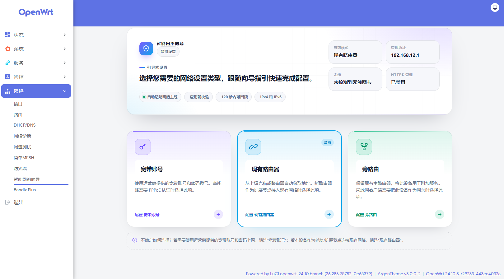

# Smart NetPilot (luci-app-smartnetpilot)

[简体中文](README.md) | English

A fool-proof network setup wizard for OpenWrt / LuCI. Pick a connection mode,
fill in the few fields the page asks for, and click **Save & Apply** — WAN,
LAN, IPv6, DNS, wireless and HTTPS are configured for you, without typing a
single Linux command.

The package lives under **Network → Smart NetPilot**
(`admin/network/smartnetpilot`). The start page offers three mode cards:

| Mode | When to use it |
| --- | --- |
| PPPoE Dial-up | Your ISP gave you a broadband account and the line needs PPPoE authentication |
| DHCP Client | The router sits behind a modem or an existing gateway and gets its WAN address automatically (a static address is possible too) |
| Side Router | Keep the existing main router and use this device for additional services |



## Installation

### From Releases

1. Open the [Releases](https://github.com/Arthur97172/luci-app-smartnetpilot/releases)
   page and download the package for your firmware.
2. Upload it to the device (for example `/tmp`), then install:

   **OpenWrt 24.10 and older (opkg)**

   ```sh
   opkg install /tmp/luci-app-smartnetpilot_*.ipk

   #Optional, Simplified Chinese language pack:

   opkg install /tmp/luci-i18n-smartnetpilot-zh-cn_*.ipk
   ```

   **OpenWrt 25.12+ (apk)**

   ```sh
   apk add --allow-untrusted /tmp/luci-app-smartnetpilot-*.apk

   #Optional, Simplified Chinese language pack:

   apk add --allow-untrusted /tmp/luci-i18n-smartnetpilot-zh-cn-*.apk
   ```

3. Refresh LuCI; the entry appears under **Network → Smart NetPilot**.

> Without the language pack the interface stays in English. The package is
> architecture independent (`all`), so one artifact works on ARM, x86, MIPS
> and every other platform.

### From source

```sh
cd openwrt
./scripts/feeds update -a
./scripts/feeds install -a
git clone https://github.com/Arthur97172/luci-app-smartnetpilot.git package/luci-app-smartnetpilot
make menuconfig     # LuCI → Applications → luci-app-smartnetpilot
make package/luci-app-smartnetpilot/compile V=s
```

The built packages end up in `bin/packages/<arch>/base/`.

## Usage

1. Open **Network → Smart NetPilot** and pick a mode on the start page. The
   mode currently in use is marked **Current**.
2. Open **WAN Settings** in the top card and fill it in according to that mode:
   - **PPPoE Dial-up**: broadband username and password; you may pick the WAN
     port and add custom DNS servers.
   - **DHCP Client**: let WAN obtain an address automatically, or choose
     **Static IPv4 address** and enter address, netmask, gateway and DNS.
   - **Side Router**: set this device's LAN address (static or assigned by the
     upstream router) and enter the main router as the gateway; **LAN DNS
     servers** are handed to LAN clients.
3. To change Wi-Fi, fill in the SSID and password under **Wireless Settings**
   (WPA2-PSK, at least 8 characters). Leave them empty to keep the current
   wireless configuration untouched.
4. **Advanced settings** reveals IPv6, the LAN DHCP server, the DNS server
   advertised to clients and HTTPS redirection; the **Other Settings** section also
   holds SYN-flood protection. On the **PPPoE Dial-up** and **DHCP Client** pages
   it also shows the LAN IPv4 address, LAN IPv4 netmask and LAN DNS servers
   (DHCP Client adds the LAN IPv4 gateway), pre-filled from the router's current
   configuration and editable in place; **Hide advanced settings** hides them
   again.
5. Click **Save & Apply** at the bottom of the page. Use **Save** first if you
   only want to stage the changes. **Back to home** in the header discards any
   unsaved edits on the page and returns to the mode chooser; nothing is saved.
6. If a change affects how you reach the device — the management address, the
   LAN DHCP role, the HTTPS setting, or the wireless name/password — a
   confirmation dialog lists what will happen before anything is applied. When
   the management address changes, the page disconnects and then opens the new
   address.
7. After applying, the device enters a 120-second confirmation window. The page
   shows a countdown and the new management address. Open the wizard at the new
   address and click **Keep configuration**; if the new address is unreachable,
   the previous configuration is restored when the countdown ends (or when you
   click **Roll back now**). Choose **Apply without confirmation** in the
   dialog to keep the new settings immediately, with no automatic rollback.

> In side-router mode, open **Advanced settings** and turn on **Disable the LAN
> DHCP server** when the main router already runs one: a network should only
> have a single DHCP server.

## How it works

The frontend only writes friendly UCI options to `/etc/config/smartnetpilot`,
e.g. `smartnetpilot.default.wan_proto=pppoe` or
`smartnetpilot.default.lan_ipaddr=192.168.2.1`. Nothing is executed by the
browser.

`/etc/init.d/smartnetpilot` translates those options into the settings the
system actually uses. It does so **only** when you click **Save & Apply**:

- Before committing, the view calls the RPC method `arm_apply`, which creates a
  one-shot request marker at `/tmp/smartnetpilot.apply`.
- With rollback enabled, `arm_apply` first calls `prepare_apply`, which snapshots
  the current configuration to `/tmp/smartnetpilot-rollback/backup` and writes a
  random token to both the state directory and the marker.
- The ucitrack `reload` hook writes configuration only when that marker exists.
  The marker is deleted as soon as it is consumed, and a marker older than
  300 seconds is ignored.
- Installation, upgrade (the package manager runs `start`), boot (the `boot`
  hook) and any other configuration commit therefore never touch the network.

The confirmation window (two-phase commit):

- After writing the configuration and restarting the network, `reload` marks the
  state `pending`, records the deadline and starts a detached timer
  (`wait_rollback`) that survives a page reload or disconnect.
- The view polls `apply_status` for the remaining time. **Keep configuration**
  calls `confirm_apply`, which cancels the timer and keeps the new settings.
- If the countdown expires unconfirmed, or the user clicks **Roll back now**,
  the timer calls `rollback_if_pending`, restores the snapshot, commits UCI,
  reloads services and records `rolledback`.
- The snapshot lives in `/tmp` and is discarded on reboot, reinstall or upgrade;
  `boot()` and uci-defaults clear this state as well.
- A new apply is refused while another one waits for confirmation, and a
  token-bearing apply with no matching snapshot is refused, so the device is
  never left with a configuration it cannot recover from.

Checks performed before anything is written:

- **Mode**: an empty `wan_proto`, or one that is not `pppoe` / `dhcp` /
  `siderouter`, is rejected — which is the state of a fresh install.
- **Required fields**: missing PPPoE credentials or an invalid static WAN/LAN
  address or netmask rejects the whole apply.
- **WAN port**: the explicitly chosen port wins, then the existing
  `network.wan` `device`/`ifname`, then the DSA `wan` port. If none is usable
  the apply is refused; it never guesses a port or rewrites the `br-lan` bridge
  port list. Candidates are checked against the `network` section of
  `/etc/board.json`: switch CPU conduits such as `eth0` on a DSA device are
  skipped and the code falls back to `wan`. VLAN sub-interfaces like `eth0.1`
  and `usb*` / `wwan*` are unaffected, and when `board.json` is unavailable
  this check is skipped.

What gets written:

- **network**: rebuilds `wan` / `wan6` for the chosen mode (PPPoE, DHCP or
  static); side-router mode rewrites LAN only. The PPPoE and DHCP modes update
  the `network.lan` address, netmask, gateway or DNS only when you changed a LAN
  field under **Advanced settings**; everything else is left untouched.
- **firewall**: recreates the WAN zone and the lan→wan forwarding, applies the
  SYN-flood switch, and adds Docker zones and forwardings when `dockerd` is
  present.
- **dhcp**: disables the LAN DHCP server on request, or advertises the chosen
  DNS server through `dhcp_option 6`.
- **wireless**: writes the SSID and password (WPA2-PSK) to every AP interface
  and to the default radios.
- **uhttpd or nginx**: toggles HTTPS and the HTTP→HTTPS redirect; without nginx
  it uses uhttpd and generates a local self-signed certificate valid for
  10 years.
- Before committing, `network`, `firewall`, `dhcp`, `wireless`, `system`,
  `uhttpd` and `nginx` are backed up to
  `/tmp/smartnetpilot_backup_<timestamp>`; if the commit fails, the backup is
  restored.
- After a successful commit, network is restarted in the background and WiFi,
  system, rpcd, uhttpd, dnsmasq and firewall are reloaded as needed.

Every IPv4 value is validated (four octets, each 0–255) before it is written;
invalid values are logged and skipped.

The `boot()` hook returns immediately, so a reboot never re-applies the
wizard's settings and cannot overwrite changes you made later by hand. The
package manager calls `start()` on install or upgrade; that hook is a no-op
too, so installing the plugin by itself never changes the network.

The frontend calls the RPC method `luci.smartnetpilot get_ip` only to display
the current LAN address and to warn about management-address changes.

## Themes and compatibility

- Works in both the light and the dark variant of the LuCI theme, with no
  manual switch.
- Adapted to `luci-theme-bootstrap` (the default in OpenWrt 24.10 / 25.12) and
  to `luci-theme-argon` 2.x / 3.x.
- Theme detection tries, in order: explicit theme markers (`data-theme`, dark
  class names), the page background luminance, then `prefers-color-scheme`; it
  also listens for theme switches and system changes.
- The stylesheet is scoped to this page, so other LuCI pages are unaffected.

## Safety notes

- Installing, upgrading and booting never apply configuration; only **Save &
  Apply** in the wizard does, and it requires a one-shot request marker.
- An apply is refused when no access mode was chosen or required fields are
  missing, so a fresh default config cannot be translated into broken network
  settings.
- An apply is refused when no usable WAN port can be determined; the code never
  guesses a port or overwrites the LAN bridge.
- `/etc/board.json` separates physical ports from switch CPU conduits: choosing
  a CPU port such as `eth0` as the WAN interface is flagged in the UI before
  saving, and the server skips it and falls back to `wan`. Devices without
  `board.json` keep the previous behavior.
- Relevant configuration files are backed up before every apply and restored
  if the commit fails.
- After a successful apply, a 120-second confirmation window restores the
  pre-apply snapshot (`network`, `firewall`, `dhcp`, `wireless`, `system`,
  `uhttpd`, `nginx`, `smartnetpilot`) when it is not confirmed, so an
  unreachable new address cannot strand the device.
- **Apply without confirmation** skips the countdown and the automatic
  rollback, taking effect immediately. If the new address is wrong the device
  may become unreachable and has to be recovered over serial, SSH, TTL or the
  failsafe mode.
- IPv4 values are validated before being written; invalid values never reach
  UCI.
- Changes that affect how you reach the device (management address, LAN DHCP
  role, HTTPS, wireless password) are confirmed before they are applied.
- When the management address changes or LAN becomes a DHCP client, the view
  commits straight to `admin/uci/apply_unchecked`, bypassing LuCI's own
  post-apply reload. The plugin's 120-second timer owns confirmation and
  rollback, so a browser disconnect cannot undo the new network configuration.
- HTTPS uses a locally generated self-signed certificate; browsers warn about
  it on first visit, which is expected. When nginx is installed, the redirect
  is configured through nginx instead.
- Applying takes a lock (`/var/lock/smartnetpilot-boot.lock`) that is treated
  as stale and removed after 300 seconds, so two apply runs never rewrite the
  network configuration at the same time.
- The wizard opens no ports or services beyond the management interface
  itself.

## Files

```
.
├── Makefile
├── htdocs/luci-static/resources/view/smartnetpilot/
│   ├── smartnetpilot.js
│   └── smartnetpilot.css
├── po/templates/smartnetpilot.pot
├── po/zh_Hans/smartnetpilot.po
└── root/
    ├── etc/config/smartnetpilot
    ├── etc/init.d/smartnetpilot
    ├── etc/uci-defaults/40-luci-smartnetpilot
    ├── usr/libexec/rpcd/luci.smartnetpilot
    └── usr/share/
        ├── luci/menu.d/luci-app-smartnetpilot.json
        ├── rpcd/acl.d/luci-app-smartnetpilot.json
        └── ucitrack/luci-app-smartnetpilot.json
```

## Requirements

- OpenWrt 24.10 or newer with LuCI (JavaScript views, `luci-base`)
- `uhttpd` (default) or `nginx` — HTTPS management is configured on whichever
  one is present
- `openssl` to generate the local certificate when HTTPS is enabled
- `dnsmasq` and the system firewall (`firewall4` / `firewall3`), both ship
  with OpenWrt
- The wireless settings need `/etc/config/wireless` and the `wifi` command; on
  a device without wireless the **Wireless Settings** button is hidden automatically

## License

GPL-3.0-only
