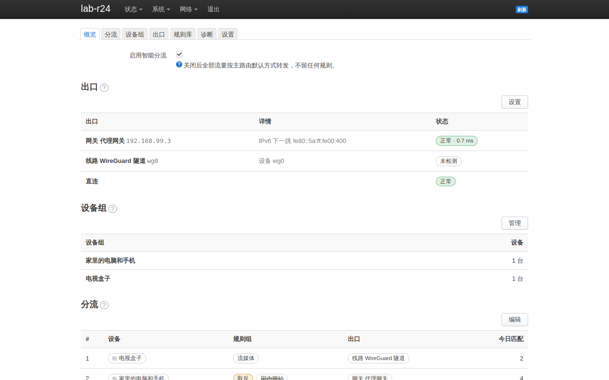
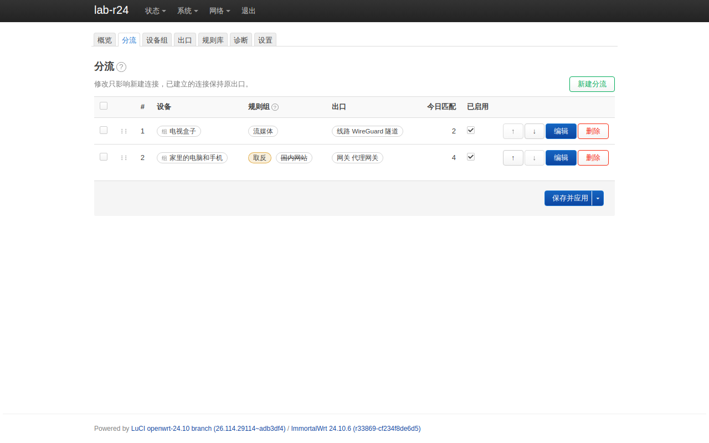
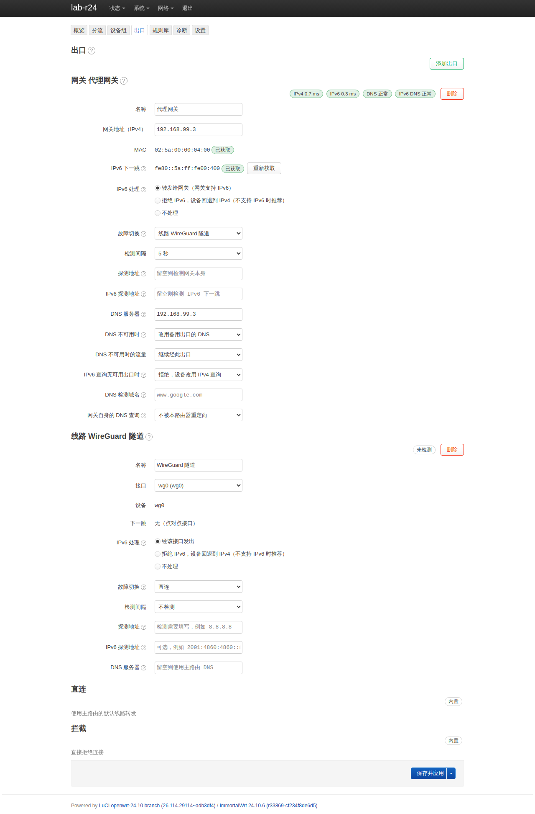

# 智能分流（luci-app-smartroute）

在 OpenWrt / ImmortalWrt 主路由上，按“哪些设备 × 访问哪些网站”决定流量从哪里出去：交给局域网里的另一台设备（网关）、走 WireGuard 隧道或第二条宽带，或者直连。IPv4 和 IPv6 一起管，设备上什么都不用改。



## 为什么需要它

用局域网里的另一台设备做代理，常见做法是把所有设备的网关和 DNS 都指向它。这样做有几个问题：

- **所有流量都要绕道这台设备**，国内流量也一样，它一出故障全家断网；
- **IPv6 管不住**。设备的 IPv6 网关来自主路由的路由通告，DHCP 改不了，于是：
  - 代理节点支持 IPv6，但设备的 IPv6 流量不经过网关，节点的 IPv6 用不上；
  - 代理节点不支持 IPv6，设备却通过主路由的 IPv6 直连，本该走代理的网站连不上，或者绕过了代理；
- 想按设备区分（孩子的平板不走代理、电视盒子只让流媒体走隧道），要么做不到，要么要手写一堆规则。

智能分流让主路由继续当所有设备的网关，只在转发时按规则改变去向：

- **只有命中规则的流量才交给网关**，其余直连；
- **IPv6 按出口单独设置**：节点支持 IPv6 时，IPv6 流量同样交给网关；不支持时，插件拒绝这些网站的 IPv6（同时屏蔽它们的 IPv6 域名解析），设备自动改用 IPv4 走网关，不会绕过代理；
- **网关故障时自动切换**到备用出口或直连，恢复后自动切回；IPv6 单独检测，只有 IPv6 不通时只处理 IPv6。

## 功能

- **按设备分流**：按 MAC 或 IP 识别设备，可编成设备组；IPv6 隐私地址会不断变化，插件按 MAC 识别，同样能管住。
- **按网站分流**：直接使用 geosite / geoip 规则库（xray 格式），每天自动更新；内置流媒体、AI 服务等常用模板。
- **多种出口**：局域网里的另一台设备（运行代理的路由器、电脑或 NAS）、WireGuard 等隧道、第二条宽带、直连、拦截。
- **故障切换**：定时检测出口，失败时切到备用出口；可以经出口检测外部地址，判断代理本身是否可用。
- **不打断已有连接**：修改分流只影响新连接；已建立的连接保持原出口。
- **兼容流量卸载**：开启软件流量卸载后规则照常生效，直连流量的转发性能不受影响。
- **诊断**：输入设备和网址，就能看到会走哪个出口、为什么；能查看每条分流今天命中了多少次。
- **多个局域网**：可同时管理主网络和访客网络等多个接口。
- 中文界面，签名软件源一键安装和升级。



## 安装

需要 ImmortalWrt / OpenWrt 24.10 或 25.12。添加签名软件源后安装：

**25.12（apk）**

```sh
wget -O /etc/apk/keys/smartroute-apk.pem https://r1172464137.github.io/luci-app-smartroute/feed/smartroute-apk.pem
echo "https://r1172464137.github.io/luci-app-smartroute/feed/25.12/$(apk --print-arch)/packages.adb" > /etc/apk/repositories.d/smartroute.list
apk update && apk add luci-app-smartroute luci-i18n-smartroute-zh-cn
```

**24.10（opkg）**

```sh
wget -O /tmp/smartroute.pub https://r1172464137.github.io/luci-app-smartroute/feed/smartroute-opkg.pub && opkg-key add /tmp/smartroute.pub
echo "src/gz smartroute https://r1172464137.github.io/luci-app-smartroute/feed/24.10/$(opkg print-architecture | awk 'END {print $2}')" >> /etc/opkg/customfeeds.conf
opkg update && opkg install luci-app-smartroute luci-i18n-smartroute-zh-cn
```

之后用系统的软件包升级即可获得新版本。也可以在 [Releases](https://github.com/r1172464137/luci-app-smartroute/releases) 下载安装包手动安装。

## 上手

安装后在 **网络 → 智能分流** 中配置，默认关闭：

1. **出口**：添加网关（填负责代理的那台设备的 IP），并选择 IPv6 处理方式——节点支持 IPv6 选“转发给网关”，不支持选“拒绝 IPv6”。
2. **设备组**：新建设备组，从扫描到的设备里勾选要分流的设备。
3. **分流**：新建一条分流，例如“家里的电脑和手机 × 非国内网站 → 代理网关”。
4. 回到 **概览** 打开总开关，保存并应用。



## 网关的配置

网关是局域网里负责代理的另一台设备，只用一个网口接在主路由下面，上网也经过主路由。它需要这样设置（以 OpenWrt 为例）：

| 项目 | 设置 |
| --- | --- |
| 地址 | 静态 IP，**网关指向主路由** |
| DHCP 与 IPv6 通告 | **关闭**，设备的地址和网关仍由主路由分配 |
| 防火墙 | lan 区域允许转发，**开启 IP 动态伪装**；要转发 IPv6 时再开启 **IPv6 伪装** |
| IPv6 | 用 DHCPv6 客户端获取地址（不请求前缀），并关闭源地址过滤（`sourcefilter=0`） |
| ICMP 重定向 | 建议关闭，避免网关让设备绕过主路由 |

**为什么必须开启动态伪装**：网关把流量转回主路由时，如果源地址仍是设备的地址，主路由会把它和“设备 → 网关”那一段当成同一个连接，不再做地址转换，流量就出不去了（已实测，IPv4、IPv6 都会失败）。代理接管的连接会以网关自己的地址重新发起，但代理没接管、只是被转发的流量仍然依赖伪装，所以请始终开启。

**IPv6 怎么选**：网关上的代理能处理 IPv6、节点也支持时，出口选“转发给网关”，并在网关上开启 IPv6 伪装；否则选“拒绝 IPv6”，网关上的 IPv6 设置都可以不管。

## 兼容性

- 系统：ImmortalWrt / OpenWrt 24.10、25.12，或基于它们的固件（如 AN7581 上的 PonWrt）；内核 6.6 及以上，不需要 BTF。
- 已在 x86_64 虚拟机上完整测试；ARM、MIPS 安装包已提供，尚未在实机上测试。
- 不需要修改设备、DHCP 或 DNS 设置；不使用 fake-ip；不处理加密 DNS（DoH），可选拦截 DoT。

## 文档

- [技术说明](docs/technical.md)：工作原理、目录结构、编译打包、UCI 配置、命令行
- [PRD](docs/PRD.md)：需求、IPv6 设计、技术方案、里程碑
- [界面原型](https://r1172464137.github.io/luci-app-smartroute/prototype/)

## 许可证

[Apache-2.0](LICENSE)
