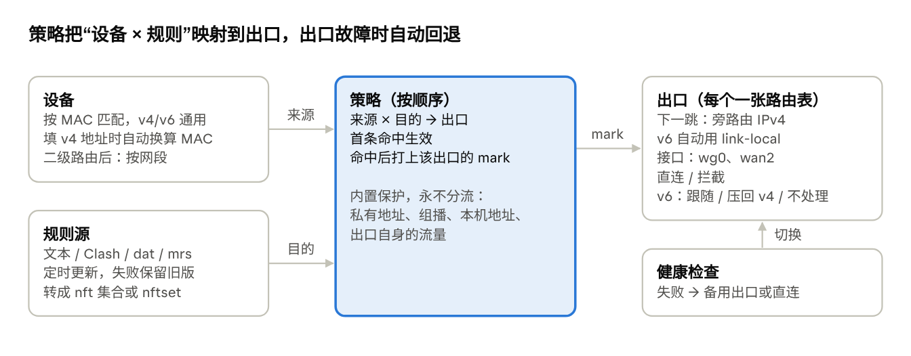

# 智能分流（luci-app-smartroute）PRD

2026-11-21

## 背景与问题

OpenWrt 上缺一个分流插件，能满足三点：在主路由上按规则把流量交给局域网里的另一台设备（网关）、规则自动维护、IPv6 可用。现有方案要么改终端网关，要么得手工导入规则。

| 现有方案 | 做法 | 主要问题 |
| --- | --- | --- |
| 终端网关指向代理设备 | DHCP 下发代理设备为网关/DNS | 全部流量绕行代理设备；代理设备故障即断网；IPv6 网关来自 RA，无法用 DHCP 改，v6 直接绕过 |
| fake-ip + 静态路由 | DNS 返回 198.18/15，主路由一条静态路由 | 改变 DNS 语义，对整体网络破坏性大，不采用 |
| pbr（luci-app-pbr） | 按 IP/域名选出口接口 | 出口只能选接口，指向同网段的另一台设备要绕；配置不顺手 |
| 爱快 端口/域名分流 | 下一跳网关 + 自定义运营商 | 规则要从别处导入、手动维护；IPv6 分流能力弱 |
| RouterOS mangle + routing table | address-list + mark-routing | 全靠手写，列表要脚本同步 |

IPv6 是最大难点，有三个原因：
- 终端的 v6 默认网关来自 RA，不受 DHCP 控制；
- 终端 v6 地址会轮换（隐私地址），无法按地址识别设备；
- 运营商前缀一变，写死的 v6 地址就会失效。

## 目标与非目标

一句话：插件装在主路由上，按“设备 × 规则”把流量改投到指定出口。v4 和 v6 同等对待，终端和 DNS 都不用改。

**目标**

1. 不改终端的网关和 DNS，不用 fake-ip；主路由始终是 v4/v6 网关。
2. IPv6 一等公民：同一条策略同时管 v4 和 v6；网关不支持 v6 时也不漏。
3. 规则源开箱即用、自动更新：纯文本列表、geosite/geoip（xray dat）；不支持 Clash 规则集与 mrs。
4. 出口可以是网关（局域网里另一台设备，比如运行代理的路由器）、线路或隧道（WireGuard、第二条 WAN）、直连或拦截。
5. 健康检查 + 自动回退：出口挂了就切到备用出口或直连，不影响全屋上网。
6. 关闭插件后网络立即恢复原样，不留残留规则。

**非目标（第一版不做）**

- 不做代理本身：不内置 mihomo/sing-box，代理由局域网里的其他设备或其他插件负责。
- 不做通用的 DNS 分流和防污染，只提供可选的“按出口转发 DNS”（N4）；不处理加密 DNS（DoH/DoT），域名规则只依据经过路由器的明文 DNS 应答。
- 不支持 fw3/iptables 旧固件，不做 Lua 界面。
- 不做负载均衡（多出口按权重分摊），只做主备。

## 目标用户与典型场景

目标用户是家庭和小型办公网络的管理者：用 ImmortalWrt/OpenWrt 做主路由，另有一台负责代理的设备或多条线路；懂基本网络概念，但不想手写 nft 和 ip rule。

| 场景 | 策略 | 出口 |
| --- | --- | --- |
| 全屋国外流量走代理网关 | 全部设备 × 非国内 IP | 网关，备用：直连 |
| 只给几台设备开代理 | 分组“需要代理”× 非国内 IP | 网关 |
| 特定域名强制走代理/直连 | 全部设备 × 域名列表 | 网关 或 直连 |
| 公司内网走隧道 | 全部设备 × 10.x 网段 | WireGuard 接口 |
| 双线路分流 | 指定设备/网段 | 第二条 WAN |
| 网关不支持 v6 | 任意策略 | 网关 + v6“压回 v4” |

## 核心概念

插件有四个概念：设备组和规则组分别描述“哪些设备”和“哪些目标地址”，分流把它们组合并指定出口，出口决定流量的转发去向。

**界面用语**：插件不假定用途。把流量转给局域网里另一台设备的出口叫“网关”，名字由用户起，默认取那台设备的主机名或地址，规则里显示为“网关 OpenWrt-2”。

**设备组**：页面的主体是一个个设备组，平时不展示局域网里扫描到的全部设备；只有往某个组“添加设备”时，才弹出扫描结果供挑选（也可手动输入 MAC / IP / 网段）。设备只有加进组，插件才会记住它；一台设备可以同时在多个组里。规则的来源只有三种：全部设备（局域网里所有设备，包括没进任何组的）、设备组、组里起过名字的单台设备。

策略按顺序匹配，首条命中的策略给流量打上对应出口的 mark。出口由健康检查守护，故障时切到备用出口或直连。

## 功能需求

优先级：P0 = 第一版必须有，P1 = 第一版尽量有，P2 = 以后再做。

### 出口

| 编号 | 需求 | 优先级 |
| --- | --- | --- |
| O1 | 网关出口：只填网关的 IPv4，插件自动得到 MAC 和 v6 link-local 下一跳（EUI-64 推算 → 邻居表按 MAC 查 → 手动填写）；名字由用户起，默认取主机名或地址 | P0 |
| O2 | 接口出口：选一个网络接口（wg0、wan2），可选自动 NAT | P1 |
| O3 | 直连、拦截（reject）两种内置出口 | P0 |
| O4 | 每个出口独立设置 v6 行为：跟随 / 压回 v4 / 不处理 | P0 |
| O5 | 健康检查：定时探测出口（ping 下一跳或探测地址），失败切到备用出口，恢复后切回 | P0 |
| O6 | 健康检查时重新解析网关的 MAC/link-local，网关换网卡后自动更新 | P0 |

### 规则库（xray 格式）

规则库由“规则数据文件”（geosite.dat / geoip.dat）和若干“规则组”组成；每个规则组是一组 xray 格式的规则，分流中可多选。

| 编号 | 需求 | 优先级 |
| --- | --- | --- |
| R1 | 订阅 geosite.dat / geoip.dat（默认 Loyalsoldier/v2ray-rules-dat），每天定时更新，可立即更新；失败保留旧版本 | P0 |
| R2 | 规则组：新建、编辑、删除（被分流引用时禁止删除）；显示展开后条目数和引用次数 | P0 |
| R3 | 规则写法：`geosite:类别`（含 `@属性`）、`geoip:类别`、`domain:`、`full:`、IP 段、`ext:文件:类别`；同一规则组内域名规则与 IP 规则可混合配置 | P0 |
| R4 | `full:` 按 `domain:` 处理并提示；`keyword:`、`regexp:`、无前缀写法不支持，导入时跳过并显示数量 | P0 |
| R5 | 编辑规则组时可搜索数据文件中的类别并一键插入；逐行校验，标出有误、将跳过、有差异的行 | P0 |
| R6 | 数据文件下载可指定出口（解决主路由直连无法访问 GitHub 的问题） | P1 |

### 分流

| 编号 | 需求 | 优先级 |
| --- | --- | --- |
| S1 | 一条分流 = 设备（全部设备 / 设备组 / 已命名设备，可多选）× 规则组（全部，或多选，可取反）× 出口 | P0 |
| S2 | 按顺序匹配，命中第一条即生效；可拖动排序 | P0 |
| S3 | 内置保护：私有地址、组播、本机地址、出口自身的流量永不分流（防环路） | P0 |
| S4 | 可选协议/端口条件（如仅 TCP 443） | P2 |
| S5 | 每条分流有启用开关 | P0 |
| S6 | 批量：勾选多条后修改出口、启用/停用、删除（可撤销） | P0 |
| S7 | 表格展示：设备、规则组、出口、今日匹配次数、启用 | P0 |

### 设备组

| 编号 | 需求 | 优先级 |
| --- | --- | --- |
| D1 | 设备组：新建、改名、删除（被规则使用时禁止删除），可折叠；组内列出设备的名字、MAC、IP、厂商（按 MAC 前缀）、在线状态 | P0 |
| D2 | 平时不展示扫描到的全部设备；点某组“添加设备”时才显示扫描结果（DHCP 租约 + 邻居表），可搜索、重新扫描，已在本组的置灰，名字默认填设备自报的主机名 | P0 |
| D3 | 添加时也可手动输入 MAC、IP 或网段，一次粘贴多行（行尾可跟名字），逐行校验 | P0 |
| D4 | 给设备起名；同一台设备在多个组里共用一个名字；没起名的设备在规则里只能按组选 | P0 |
| D5 | 批量：组内全选或勾选多台设备，复制到 / 移到另一个组、移出所在组（可撤销）；不在任何组的设备被插件忘掉，被规则直接选中的设备不允许移出最后一个组 | P0 |
| D6 | 规则类型：每个设备条目为 MAC 规则或 IP 规则，可在设备表中切换（需对应的 MAC 或 IP 可用）。MAC 规则按 MAC 匹配 IPv4 与 IPv6 流量，当前 IP 由 DHCP 租约与邻居表自动更新、仅用于显示；IP 规则按 IP 匹配 IPv4 流量，并通过该 IP 当前对应的 MAC 匹配 IPv6 流量；网段条目为 IP 规则，按地址段匹配。扫描添加时逐台选择规则类型，手动添加按地址格式自动确定 | P0 |
| D9 | IP 规则的 IPv6 关联状态：已关联（显示关联的 MAC，可一键改为 MAC 规则）/ 仅 IPv4 生效（附原因与处理建议）；未关联时设备 IPv6 流量的处理方式在设置中选择：不参与分流（默认）或拒绝 IPv6 使设备回退到 IPv4 | P0 |
| D7 | 随机 MAC 的设备标注出来，并提示在手机上改成“每个网络固定” | P1 |
| D8 | 网段条目按 v4/v6 网段匹配，用于二级路由/隧道后拿不到 MAC 的设备 | P1 |

### 域名分流

| 编号 | 需求 | 优先级 |
| --- | --- | --- |
| N1 | eBPF 在 LAN 口读取发往设备的明文 DNS 应答（不限设备使用哪个 DNS 服务器），记录 v4/v6 的“域名 → IP”后再放行 | P0 |
| N2 | 出口 v6 行为为“压回 v4”时，对命中域名只屏蔽 AAAA | P1 |
| N3 | 域名记录可设置最短保留时间，重启后可恢复；DNS over TCP 应答、加密 DNS 不处理 | P0 |
| N4 | 出口可选配置 DNS：命中分流的设备查询命中的域名时，明文 DNS 查询（UDP；紧随其后的 TCP 重查跟随同一出口）经该出口发往其 DNS。出口 DNS 按检测间隔实际解析检测域名；不可用时按出口设置沿故障切换链回退、改用主路由 DNS 或不切换，可选让流量一并切换。IPv6 查询只交给有 IPv6 路由的出口，找不到时按设置拒绝（设备改查 IPv4）或交给主路由。网关出口可选让网关自身的 DNS 查询不被主路由的 DNS 劫持（默认开启） | P1 |

## IPv6 设计要点

主路由始终是 v6 网关，插件只在转发时改下一跳，因此完全绕开了 RA 的问题。v6 与 v4 用同一套机制，只需处理下表四个 v6 特有的坑。

| 问题 | 处理方式 | POC 状态 |
| --- | --- | --- |
| 下一跳不能用公网 v6（前缀会变） | 用网关的 link-local 地址，依次尝试：EUI-64 推算并 ping 验证 → 组播 ping ff02::1 后在邻居表按 MAC 查 → 手动填写 | EUI-64 路径已验证 |
| 终端 v6 地址轮换（隐私/临时地址） | 来源一律按 MAC（ether saddr）匹配；EUI-64 对终端无效，不用 | 已验证（临时地址仍被命中） |
| 主路由发 ICMPv6 重定向，终端绕过主路由直连网关 | 出方向丢弃 nd-redirect；v4 关闭 send_redirects | 已应用，待专项测试 |
| 网关不一定支持 v6 | 每个出口三选一：跟随（v6 同样交给出口）；压回 v4（命中的 v6 回 reject，终端 Happy Eyeballs 回退 v4，域名规则同时屏蔽 AAAA）；不处理 | 已验证：出口表里的 v6 prohibit 使命中的 v6 连接立即失败；AAAA 屏蔽待实现 |

用户填 v4 地址选设备时，v6 包里没有 v4 地址，所以插件先把它换算成 MAC 再匹配，这台设备的 v6 流量也就一并管住了。如果二级路由对 v6 是路由模式，就只能按整台二级路由分流。

## 界面需求（LuCI）

菜单位于“网络 → 智能分流”，共七个标签页，用 LuCI JS（form.Map）实现，不写 Lua。可点击的原型：[界面原型](https://r1172464137.github.io/luci-app-smartroute/prototype/)。

| 标签页 | 内容 |
| --- | --- |
| 概览 | 总开关；出口状态；设备组概况；分流表格与今日匹配次数；需要处理的问题（如 drop_invalid）带一键修复 |
| 分流 | 表格（设备 / 规则组 / 出口 / 今日匹配 / 启用），拖动排序，批量修改出口、启用/停用、删除 |
| 设备组 | 可折叠的设备组；添加设备时显示扫描结果并可手动输入；命名；批量复制/移动/移出 |
| 出口 | 网关：名称、地址、自动获取的 MAC 与 IPv6 下一跳、IPv6 处理方式、故障切换、检测间隔；线路/隧道；直连；拦截 |
| 规则库 | 规则数据文件状态与更新；规则组列表与编辑（xray 格式、类别插入、逐行校验） |
| 诊断 | 运行状态自检（内核、程序、域名记录、连接记录、路由表、网关、防火墙兼容、流量卸载、规则组）；流量走向测试（选设备 + 输入域名/IP，逐条显示匹配过程和出口）；域名记录查询；最近事件；复制诊断信息 |
| 设置 | 工作接口、IPv6 开关；域名记录最短保留时间、重启后保留；已建立连接保持原出口、空闲超时；数据文件地址、更新时间、下载出口；自动放行（drop_invalid）；高级：流量标记、路由表编号；导入/导出配置 |

点“保存并应用”后 3 秒内生效；数据文件在后台下载，不阻塞页面。

**用语**：使用规范的功能名称（分流、设备组、规则组、出口、网关），不用口语化句子；不常见的名词旁放问号，悬停、聚焦或点击显示一两句说明；MAC、IP 等常见词不加。

## 技术方案概要

数据面全部在 eBPF 中完成：读取 DNS 应答记录“域名 → IP”，并在连接的第一个包上完成设备、规则组、出口的判断与打标；转发沿用内核策略路由。eBPF 可行性已在 ImmortalWrt 24.10 与 25.12 上验证（见验证计划）。

| 层 | 实现 | 职责 |
| --- | --- | --- |
| 界面 | LuCI JS + rpcd ACL | 配置与状态展示 |
| 配置 | UCI `/etc/config/smartroute` | 设备组、分流、出口、规则组、设置 |
| 后台服务 | procd 服务，Go 静态程序（cilium/ebpf，无 cgo，交叉编译各架构） | 解析 geosite/geoip 与规则组并装入 eBPF 表；扫描设备、刷新 IP 与 MAC 关联；网关健康检查与 v6 下一跳解析；数据文件定时更新 |
| 判断（eBPF，tc，LAN 口） | 一个 eBPF 对象，同一产物兼容内核 6.6 / 6.12（不依赖内核 BTF） | egress：读取发往设备的明文 DNS 应答，记录“域名 → IP”后放行；ingress：新连接首包按“设备 → 分流顺序 → 规则组 → 出口”判断并打标，记录该连接，后续包沿用 |
| 转发 | `ip rule fwmark` + 每个出口一张路由表 | v4 下一跳 = 网关 IP，v6 下一跳 = 网关 link-local；线路/隧道为接口路由 |
| 防火墙 | fw4 include 一条规则 | 放行已打标流量，避免“丢弃无效数据包”误伤 |

eBPF 中使用的表：

| 表 | 类型 | 内容 |
| --- | --- | --- |
| 设备 | 哈希（MAC）/ 前缀树（IP、网段） | 设备 → 所属设备组 |
| 规则组 IP | 前缀树（LPM） | geoip、IP 段 → 规则组 |
| 规则组域名 | 哈希（域名后缀的 64 位哈希） | geosite、domain:、full: → 规则组；按标签逐级查后缀 |
| 域名记录 | LRU 哈希 | IP → 域名、有效期（读取 DNS 应答生成，可持久化） |
| 连接 | LRU 哈希（五元组） | 连接 → 出口；空闲超时淘汰 |
| 分流 | 数组 | 按顺序的分流条目（设备组位图、规则组位图、取反、出口标记） |

一个包的处理顺序：

1. DNS 应答经过 LAN 口 egress：解析出域名与 A/AAAA，写入域名记录，再放行给设备。
2. 设备发出连接的第一个包经过 LAN 口 ingress：跳过内置保护地址和出口自身流量。
3. 查连接表：已有记录则沿用其出口；没有则按分流顺序判断（设备 → 规则组：目标 IP 先查规则组 IP，再查域名记录对应的域名后缀），命中第一条即打标并写入连接表。
4. 路由阶段 ip rule 按标记查对应出口的路由表转发。
5. 出口失效时，健康检查改写该出口的路由表为备用出口（或删除以回落直连）。

**出口按连接固定（PVE 实测后确定）**：出口只在连接建立时选定，后续的包沿用；修改分流、开关插件都不会打断已有连接。经网关的连接回包不经过主路由（主路由 conntrack 判为 invalid），因此连接记录由 eBPF 自行维护，不依赖 conntrack。网关真正故障时，经过它的连接必然中断（网关做了 SNAT），新连接按回退出口走。

## 非功能需求

最重要的一条：插件出问题时，网络退回直连，而不是断网。

| 类别 | 要求 |
| --- | --- |
| 可靠性 | 出口故障在一个检查周期内完成切换（默认 10 秒内）；插件停止或卸载后不留任何 nft/ip rule 残留 |
| 可靠性 | 规则源更新失败时保留旧集合；解析出的条目数异常（如为 0）时不覆盖 |
| 可靠性 | fw4 重载、netifd 重载、WAN 重拨、v6 前缀变化后规则仍然有效 |
| 性能 | 单个 interval set 在 10 万条以内时，转发吞吐下降不超过 5%（目标值待实测确认） |
| 性能 | 与软件流量卸载兼容：已卸载的连接仍走正确出口（已在 24.10.6 / 25.12.2 实测通过，两版默认都开启卸载） |
| 资源 | 256 MB 内存的设备可用；规则生成时的峰值内存 < 30 MB（待实测） |
| 兼容性 | ImmortalWrt 24.10（fw4、nftables、opkg）与 25.12（apk、内核 6.12）均已通过 POC 测试 |
| 兼容性 | fw4 开启“丢弃无效数据包”（drop_invalid）时，经网关的连接会被主路由丢弃（已实测）：插件需在 forward 链最前面放行已打标的流量，或检测到后提示 |
| 兼容性 | 与 OpenClash、nikki、HomeProxy、PassWall 等装在同一台机器时互不冲突：mark 与路由表号可配置，并避开它们的常用值 |
| 安全 | 规则源 URL 仅允许 http/https；下载内容只作为数据解析，不执行；rpcd ACL 只开放本插件所需接口 |

## 验证计划

在 PVE 隔离虚拟机上开发和验证（M0 阶段另用过 Docker 环境，M3 已删除）；生产主路由不参与测试。

**PVE 测试环境（已搭建）**：仓库的 [`test/pve/`](../test/pve) 目录。被测路由为 ImmortalWrt 24.10.6 和 25.12.2 虚拟机（真实内核、默认开启流量卸载），网关为 ImmortalWrt，客户端为 Alpine 虚拟机里的 netns（client-a 开启 v6 临时地址），“运营商”虚拟机模拟国内/国外目标和委派前缀。

**Docker 测试环境（已搭建）**：仓库的 [`lab/`](https://github.com/r1172464137/luci-app-smartroute/tree/8fce04d/lab)（已于 M3 删除，改用 PVE） 目录。用 `sudo ./up.sh` 启动，`./check.sh` 输出测试矩阵。环境里有三类容器：
- router：ImmortalWrt 24.10.6；
- side：网关，做 SNAT，以源地址判断流量是否经过它；
- target：用 223.5.5.5 / 240e::1 扮演国内地址，用 8.8.8.8 / 2001:4860::8888 扮演国外地址。

**POC 结果（2026-11-21，Docker 与 PVE 的 24.10.6 / 25.12.2 一致）**

| 客户端 | 国内 v4 | 国外 v4 | 国内 v6 | 国外 v6 |
| --- | --- | --- | --- | --- |
| client-a（按 MAC 选中，启用临时隐私地址） | 直连 | 网关 | 直连 | 网关 |
| client-b（对照组） | 直连 | 直连 | 直连 | 直连 |

**流量卸载与规则变更（PVE，24.10.6 与 25.12.2 结果相同；40MB 下载，按网关收包量判断）**

| 场景 | 卸载开启 | 卸载关闭 |
| --- | --- | --- |
| 国外 v4 长连接 | 全程经网关 | 全程经网关 |
| 国外 v6 长连接 | 全程经网关 | 全程经网关 |
| 下载中途开启规则 | 旧连接保持直连、不中断 | 旧连接保持直连、不中断 |
| 下载中途把设备移出名单 | 旧连接保持经网关、不中断 | 旧连接保持经网关、不中断 |

**待测项**

- [x] eBPF：24.10 / 25.12 内核 BTF、tc 挂载、读取 DNS 应答（v4/v6、路由器 DNS 与外部 DNS）均通过，详见 [`ebpf-poc/`](https://github.com/r1172464137/luci-app-smartroute/tree/8fce04d/ebpf-poc)（已删除，见历史版本）
- [x] eBPF：首包判断与打标、连接记录、与流量卸载共存（24.10 / 25.12 通过，含域名规则、IP 规则关联 MAC 管 v6），详见 [`ebpf/`](../ebpf)
- [x] fw4 include 方式下 fw4 重载后规则保留
- [x] 健康检查：网关探测失败 8 秒内回退直连，恢复后 8 秒内切回（默认间隔 5 秒，连续 2 次判定）；也可经网关探测外部地址
- [x] v6“压回 v4”：命中的 v6 连接立即被拒绝（prohibit），v4 照常经网关
- [x] 网关改用随机 link-local：插件运行中自动重新找到下一跳（约 25 秒）；网关不应答组播 ping 时按邻居表里网关 MAC 的地址找（2026-11-22）
- [x] 用户填 v4 地址时自动换算 MAC 并管住 v6（每 30 秒按邻居表 / DHCP 租约刷新）
- [x] ICMP/ICMPv6 重定向已被抑制：经网关的连接后客户端路由未被改写（2026-11-22）
- [x] （PVE）软件流量卸载开启时规则有效
- [x] （PVE）ImmortalWrt 25.12 兼容
- [x] （PVE）真实 RA/SLAAC（含 v6 临时地址）
- [x] （PVE）v6 前缀变化：不重启插件，新前缀下设备照常分流、新 LAN 前缀自动受保护（2026-11-22）；WAN 拨号（PPPoE）实验环境没有，未测
- [x] fw4 drop_invalid=1 时的放行规则（include 放在 forward 链最前，只放行已打标且 conntrack 判为无效的包）
- [x] （PVE）大规则集下的吞吐：插件开关前后直连吞吐无差别（x86 虚拟机约 10 Gbit/s，在测量误差内），满足 ≤5% 的目标（2026-11-22）。内存已测：geosite:cn + geolocation-!cn + geoip:cn 共 14.7 万条，峰值 21 MB（含约 7.6 MB 映射的数据文件页），常驻约 3 MB；x86 虚拟机上重新加载 1.8–1.9 秒）

## 里程碑

各阶段没有定日期，过了门槛就进入下一阶段。验收以 PVE 测试环境为准。

| 里程碑 | 内容 | 门槛 | 状态 |
| --- | --- | --- | --- |
| M0 测试环境 | Docker / PVE 测试环境，nft 版 POC，eBPF 读取 DNS 应答 | POC 通过 | 已完成 |
| M1 核心后端 | eBPF 首包判断与连接表；Go 后台：UCI 配置编译、网关出口（MAC + v6 下一跳）、路由表、fw4 include、procd；geosite/geoip 解析与定时更新 | PVE 测试矩阵通过（24.10 + 25.12），大规则集内存达标 | 已完成（2026-11-21） |
| M2 可用版 | 健康检查与回退、v6 下一跳重新解析、压回 v4；地址/接口变化监听；域名记录持久化；LuCI 界面；ipk / apk 打包 | PVE 整体验证通过 | 已完成（2026-11-21）。AAAA 屏蔽（N2，P1）未做 |
| M3 扩展 | 接口出口（WireGuard、第二条 WAN）、内置规则模板（xray 格式）、AAAA 屏蔽；另见 M3 清单（v6 健康探测、多工作接口、DoT 拦截、中文语言包、签名软件源等） | 在 .202 上线验收 | PVE 回归通过（2026-11-22，24.10 / 25.12，`test/pve/backend-test.sh` 15 项）；待 .202 上线 |

M1 不做界面，全部用 UCI 配置（示例见 [`test/pve/sr.sh`](../test/pve/sr.sh)）。

## 开放问题

- [ ] 包名：界面显示“智能分流”，包名暂定 `luci-app-smartroute`，是否确认？
- [x] 许可证：Apache-2.0（2026-11-21）
- [x] dat 解析：后台自己解析 protobuf，只读被引用的类别（2026-11-21）。不支持 mrs（2026-11-22 决定）。
- [ ] 规则源更新的下载通道：主路由自己下不到 GitHub 时，是走指定出口，还是内置镜像地址？
- [ ] 负载均衡暂列为非目标，是否确实不需要？
- [x] 安装包：24.10 出 ipk、25.12 出 apk，两种都出，并提供签名软件源（2026-11-21）
- [x] 接口出口的 NAT：要求用户把接口放进已开启伪装的防火墙区域，插件只检查并提示（2026-11-21）
- [x] mark 与路由表号的默认值：mark 掩码 0x1f000000（最多 31 个出口），路由表号与 ip rule 优先级 3101 起。OpenClash 用 0x162 / 表 354，nikki、HomeProxy、PassWall 用低位小数值，不冲突。
