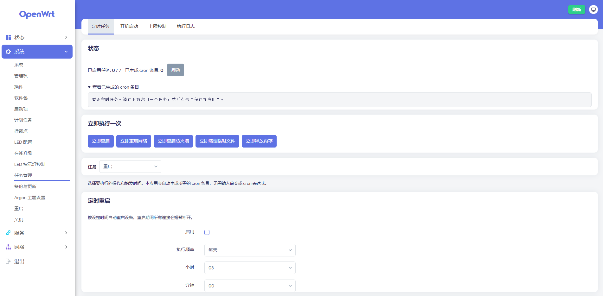

# 任务管理（luci-app-tasks）

简体中文 | [English](README.en.md)

一个面向 OpenWrt / LuCI 的「傻瓜式」任务管理插件。所有操作都通过开关、下拉框和时间选择器完成——你不需要输入任何 Linux 命令、cron 表达式或脚本。

插件位于 **系统 → 任务管理**（`admin/system/tasks`），共四个页面：

| 页面 | 功能 |
| --- | --- |
| 定时任务 | 定时重启、定时重启网络、定时重启防火墙、定时清理 `/tmp`、定时释放内存、定时开启/关闭 WiFi，并提供「立即执行」按钮 |
| 开机启动 | 每次开机后延迟启动某个系统服务，或执行一条自定义命令 |
| 上网控制 | 按 MAC/IP 指定设备，在允许的时间段之外自动禁止其上网，每分钟检查一次 |
| 执行日志 | 记录定时任务、手动执行和上网控制的结果，支持清空与下载 |



## 安装

### 从 Releases 安装

1. 打开 [Releases](https://github.com/Arthur97172/luci-app-tasks/releases) 页面，下载安装包。
2. 把安装包上传到设备（例如 `/tmp`），然后安装：

   **OpenWrt 24.10 及更早（opkg）**

   ```sh
   opkg install /tmp/luci-app-tasks_*.ipk

   #可选，安装简体中文语言包：

   opkg install /tmp/luci-i18n-tasks-zh-cn_*.ipk
   ```

   **OpenWrt 25.12+（apk）**

   ```sh
   apk add --allow-untrusted /tmp/luci-app-tasks-*.apk

   #可选，安装简体中文语言包：

   apk add --allow-untrusted /tmp/luci-i18n-tasks-zh-cn-*.apk
   ```

3. 刷新 LuCI，入口出现在「系统 → 任务管理」。

> 未安装语言包时界面显示英文。安装包架构为 `all`，ARM / x86 / MIPS 等平台通用。

### 从源码编译

```sh
cd openwrt
./scripts/feeds update -a
./scripts/feeds install -a
git clone https://github.com/Arthur97172/luci-app-tasks.git package/luci-app-tasks
make menuconfig     # LuCI → Applications → luci-app-tasks
make package/luci-app-tasks/compile V=s
```

编译产物位于 `bin/packages/<架构>/base/` 目录下。

## 使用方法

1. 打开「系统 → 任务管理 → 定时任务」。
2. 在顶部的「任务」下拉菜单中选择要设置的任务，打开「启用」，再选择运行方式（每天 / 每周 / 每月 / 每小时 / 每隔几分钟 / 每隔几小时）并设定时间。
3. 点击页面底部的「保存并应用」。插件会自动生成 cron 条目——页面顶部的状态区会显示实际写入的内容。只想暂存修改时，可以先点「保存」。
4. 想立刻执行一次时，使用「立即执行」工具栏中的按钮，无需等到设定时间。

在「定时任务」的下拉菜单里，「开启WiFi」和「关闭WiFi」可以按时间自动打开或关闭所有无线网络；关闭后有线设备和路由器本身仍可正常使用，开关状态会写入配置，重启后依然有效。

「开机启动」页用于添加开机后要运行的服务或命令；「执行日志」页会实时（每 5 秒）显示执行结果。

「上网控制」页用于限制设备上网：添加一台设备，填写 MAC 地址或 IP 地址，选择生效的星期和允许上网的时间段，然后「保存并应用」即可。设备在时间段之外会被禁止上网，但仍可访问路由器本身。「始终禁止上网」模式可以随时切断某台设备。建议填写 MAC 地址，这样 DHCP 更换 IP 或使用 IPv6 时规则仍然有效。

## 工作原理

前端只把易读的 UCI 选项写入 `/etc/config/tasks`，例如
`tasks.reboot.mode=daily`、`tasks.reboot.hour=03`，浏览器本身不执行任何命令。

`/etc/init.d/tasks` 负责把这些选项翻译成系统真正使用的东西：

- `/etc/crontabs/root` 中每个启用的任务对应一行，并带有 `# luci-app-tasks:<动作>` 标记；只会删除带该标记的行，不会碰你自己添加的 cron 任务。
- `/etc/tasks/startup.sh` 每次保存后重新生成，由 init 脚本的 `boot()` 钩子执行。
- 上网控制启用且至少有一台设备时，crontab 中会增加一行每分钟执行 `tasks-handler run access` 的任务。该脚本把当前应被禁止的设备写入 nftables 表 `tasks_access`；没有 nft 时改用 iptables 链 `TASKS_ACCESS`。规则只拦截转发流量，不拦截设备访问路由器本身。
- `/usr/bin/tasks-handler` 执行真正的动作，只接受 `reboot`、`network`、`firewall`、`cleantmp`、`clearmem`、`wifion`、`wifioff`、`access` 等固定名称；自定义命令在运行时从 UCI 读取，不会写进 cron。

因为 cron 行是由 init 脚本生成的（而不是浏览器），前端无法把任意文本注入 crontab。

## 主题与兼容性

- 支持 LuCI 亮色 / 暗色主题，无需手动切换。
- 已适配 `luci-theme-bootstrap`（OpenWrt 24.10 / 25.12 默认主题）与 `luci-theme-argon` 2.x / 3.x。
- 样式表只使用主题提供的 CSS 变量，并带中性兜底值，因此未知主题下也能自动获得可读的文字颜色。

## 安全说明

- 清理 `/tmp` 默认只删除已知的 LuCI / opkg 缓存；「按时间清理」模式会跳过 `*.pid` 和 `*.lock`。
- 释放内存执行的是 `sync && echo 3 > /proc/sys/vm/drop_caches`，安全但不宜过于频繁。
- 开机启动中的「系统服务」项调用 `/etc/init.d/<服务> start`，不会修改该服务自身的开机自启设置。
- 上网控制只拦截经过路由器的转发流量，被限制的设备仍可打开路由器管理页面以便解除限制；使用 MAC 地址作为目标可同时覆盖 IPv4 与 IPv6。
- 上网控制的当前状态保存在 `/etc/tasks/access.state`，日志只记录设备被禁止或恢复的瞬间，避免刷屏。
- 日志上限 500 行，保存在 `/etc/tasks/tasks.log`。

## 文件结构

```
.
├── Makefile
├── htdocs/luci-static/resources/view/tasks.css
├── htdocs/luci-static/resources/view/tasks/
│   ├── scheduled.js
│   ├── startup.js
│   ├── access.js
│   └── log.js
├── po/templates/tasks.pot
├── po/zh_Hans/tasks.po
└── root/
    ├── etc/config/tasks
    ├── etc/init.d/tasks
    ├── etc/uci-defaults/luci-tasks
    ├── usr/bin/tasks-handler
    ├── usr/lib/tasks/common.sh
    └── usr/share/{luci/menu.d,rpcd/acl.d}/luci-app-tasks.json
```

## 依赖

- OpenWrt 24.10 或更新版本，带 LuCI（JavaScript 视图，`luci-base`）
- `cron`（BusyBox `crond`）：只要有生成的任务，init 脚本会自动启用并启动它
- 防火墙后端：`nftables`（firewall4）或 `iptables`（firewall3），系统自带其一即可
- WiFi 开关任务需要设备存在 `/etc/config/wireless` 且提供 `wifi` 命令；无无线的设备上执行时会记录错误并跳过

## 许可证

GPL-3.0-only
