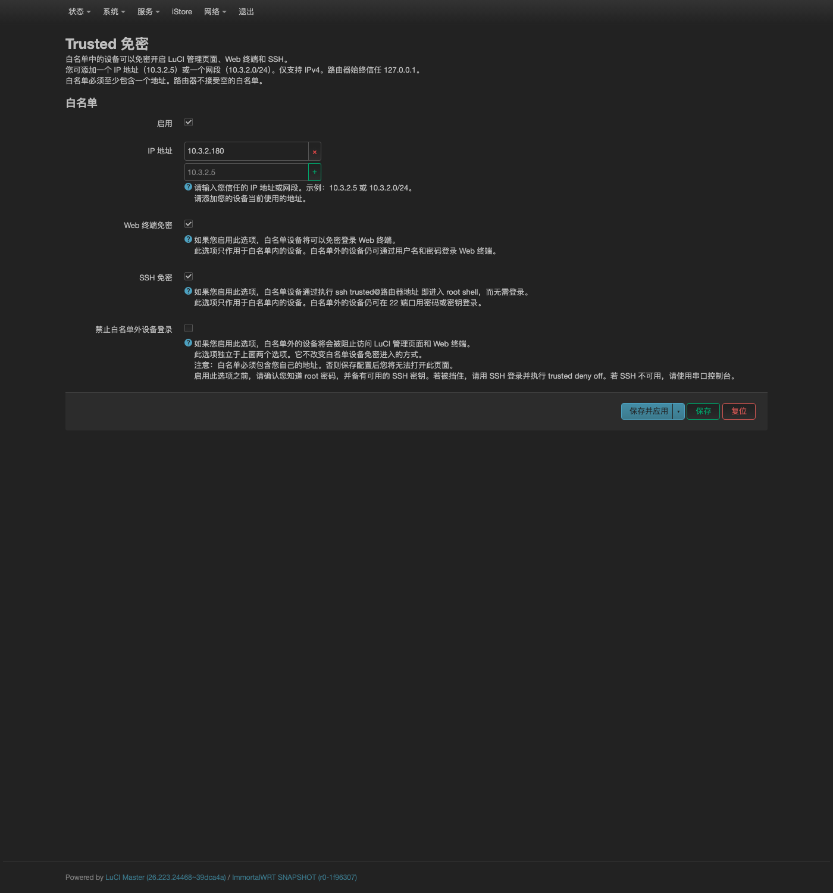
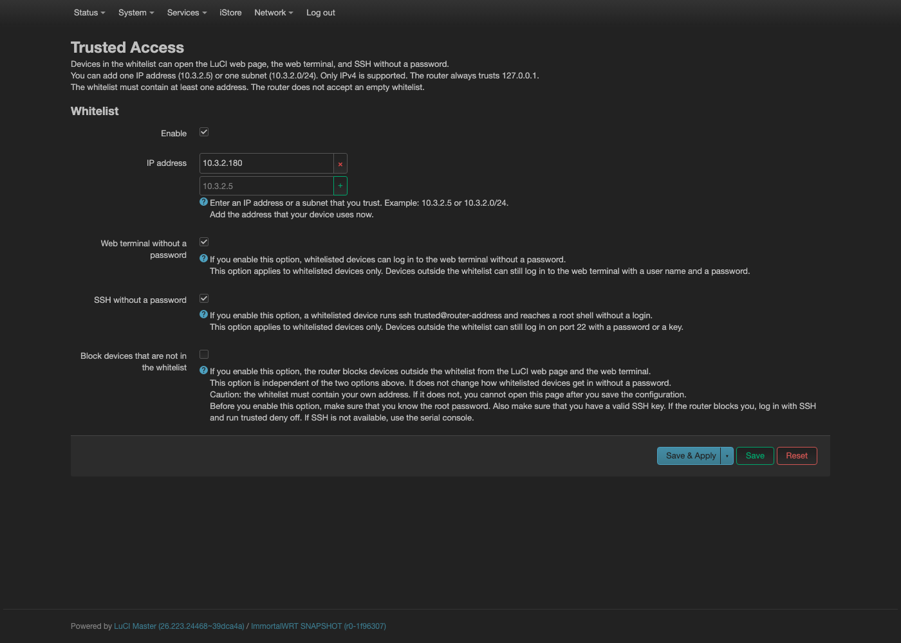

# luci-app-trusted

本插件为 OpenWrt 和 ImmortalWRT 提供 IP 白名单免密登录。

白名单中的 IP 访问下面三项时，不用输入账号密码：

- 管理页面（LuCI）
- Web 终端（ttyd）
- SSH

本插件只支持 ucode 版 LuCI。目标系统为 OpenWrt 23.05 或更新版本。纯 Lua 版 LuCI 不支持。

## 界面

中文界面：



英文界面：



## 安装

先上传安装包，再执行安装：

```sh
scp luci-app-trusted_1.3.0-1_all.ipk root@router:/tmp/
ssh root@router 'opkg install /tmp/luci-app-trusted_1.3.0-1_all.ipk'
```

安装包的架构是 `all`。任意架构的机器都能安装它。

安装包不声明依赖。目标机的 opkg 可能没有软件源数据库，所以插件不写 Depends。插件运行需要 `ucode` 和 `luci-base`。卸载时如果 opkg 提示依赖问题，请加 `--force-depends`。

postinst 脚本自动执行 `enable`，并重启一次服务。因此路由器重启后，插件仍然生效。

## 从源码构建

构建脚本只需要 Python 3。它按目录结构直接打包：

```sh
python3 build-ipk.py
```

脚本产出 `luci-app-trusted_1.3.0-1_all.ipk`。版本号写在脚本顶部的 `VER`。

脚本同时编译 `po/zh_Hans/trusted.po`，产出 `trusted.zh-cn.lmo`。这个编译器的输出与官方 `po2lmo` 逐字节相同。

## 使用

按下面的步骤配置：

1. 用浏览器打开 LuCI。
2. 进入菜单 **System → Trusted 免密**。英文界面下这个菜单叫 **Trusted Access**。
3. 勾选 **启用**。
4. 在 **IP 地址** 中添加 IP 或网段。例如 `10.3.2.180` 或 `10.3.2.0/24`。插件只接受 IPv4。请先加入你自己当前使用的地址。
5. 要免密使用终端，请勾选 **Web 终端免密**。
6. 要免密使用 SSH，请勾选 **SSH 免密**。白名单中的设备执行 `ssh trusted@<路由器地址>` 即可进入 root shell。
7. 要拦截白名单以外的设备，请勾选 **禁止白名单外设备登录**。
8. 保存配置。配置立即生效。改动白名单后，已注入的会话立即失效。

三个开关互相独立。每个开关只控制自己的范围。白名单以外的设备默认用账号密码登录。

白名单不能为空。启用后至少要有一个地址。表单会拒绝空列表。**禁止白名单外设备登录** 也要求白名单非空，否则不允许保存。

也可以在 SSH 或串口下用 `trusted` 命令管理，见下面的「命令行工具」。

| 开关组合 | 白名单中的设备 | 白名单以外的设备 |
|---|---|---|
| 全部关闭 | 用账号密码登录 | 用账号密码登录 |
| 启用 | 免密进入管理页面 | 用账号密码登录管理页面 |
| 启用 + Web 终端免密 | 访问 7681 端口直接进入 root shell | 在终端用账号密码登录 |
| 启用 + SSH 免密 | `ssh trusted@路由器地址` 免密进入 root shell | 22 端口照常用密码或密钥登录 |
| 启用 + 禁止白名单外设备登录 | 不受影响 | 无法连接管理页面和终端。防火墙丢弃数据包，不显示登录页 |

打开 **禁止白名单外设备登录** 后，白名单外设备的数据包被静默丢弃。防火墙不返回任何回应。浏览器不显示错误页。页面会一直加载，直到超时。

## 工作原理

### 管理页面：只注入会话

插件把 `/www/cgi-bin/luci` 换成一个很小的包装脚本。包装脚本的路径是 `/usr/share/trusted/cgi-luci.wrapper`。

插件先把原版 CGI 完整保存到 `/usr/share/trusted/cgi-luci.stock`。包装脚本直接 `exec` 这个原版 CGI。

包装脚本只判断白名单。请求来自白名单 IP 且没有登录 cookie 时，包装脚本执行两个动作。它先把 rpcd 会话 id 写入 `HTTP_COOKIE`，然后 `exec` 原版 CGI。

这时 CGI 看到的状态与密码登录成功后完全相同。因此 LuCI 的认证链、ACL 检查和 `/ubus` JSON-RPC 代理都走正常的管理员路径。

早期版本把上游 CGI 整份复制，再加两行 hook。这样做有两个问题。第一，`luci-base` 升级后，复制品与上游脱节。第二，脱节后插件静默失效。现在插件不再复制上游代码。每次启动时，插件重新保存新的上游脚本。

`session.uc` 创建会话。它依次执行 `session create`、`set`、`grant`。它给会话授予全部 ACL 组，以及 ubus、uci、file 的全部权限。插件按客户端 IP 缓存会话，缓存在 `/var/run/trusted/sid/`。目录权限是 `0700`，文件权限是 `0600`，只有 root 可以读。缓存命中时，每个请求多执行一次 `ubus call session get`，用来确认会话未过期。这次调用约 3 ms。

### Web 终端：两个实例

- LuCI 自带的 ttyd 监听 7681 端口。插件不改它，任何人打开它都要用账号密码登录。
- 插件另起一个免密实例，监听 7682 端口。这个实例执行 `/bin/login -f root`。它只绑定 `br-lan` 的地址。
- 防火墙把白名单 IP 发往 7681 端口的数据包重定向到 7682 端口。

### SSH：两个实例加守门脚本

- 插件另起一个 dropbear 实例，监听 2222 端口。这个实例带 `-B` 参数，允许空密码登录。它只绑定 `br-lan` 的地址。
- 插件创建一个 `trusted` 账号，uid 为 0。插件把 `/etc/shadow` 中该账号的密码哈希置空。
- 系统自带的 dropbear 监听 22 端口，不带 `-B` 参数。插件不改它，所有人照常用密码或密钥登录。
- 防火墙把白名单 IP 发往 22 端口的数据包重定向到 2222 端口。因此白名单中的设备执行 `ssh trusted@路由器地址` 就能免密进入，不用记端口号。
- 守门脚本控制这个账号的使用范围。busybox 的 `/bin/login` 也接受空密码。不加限制时，任何人从终端或串口登录页用 `trusted` 加空密码就能拿到 root。因此插件把 `trusted` 账号的登录 shell 指向 `/usr/share/trusted/ssh-shell`。这个脚本只在两种情况下执行 `/bin/ash`：一是 `TRUSTED_SSH=1`，二是父进程为 `dropbear`。免密 dropbear 实例通过 `procd_set_param env` 和 `-e` 注入 `TRUSTED_SSH=1`。其他情况脚本直接退出。这样 `trusted` 账号只能用于白名单免密 SSH。
- dropbear 检查登录 shell 是否登记在 `/etc/shells`。因此插件创建账号时把守门脚本写入 `/etc/shells`，删除账号时一并移除。

### 防火墙：独立规则表

插件把自己的规则写入 `table inet trusted`。插件用一次事务加载全部规则，用 `nft delete table inet trusted` 整体卸载。

```
table inet trusted {
    set wl4 { type ipv4_addr; flags interval; elements = { 127.0.0.1, 10.3.2.180 } }
    chain input      { type filter hook input priority filter - 1; ... }   # 端口门禁
    chain prerouting { type nat hook prerouting priority dstnat - 5; ... }  # 白名单重定向
}
```

插件用独立规则表，有四个理由。每个理由都来自一次实测故障。

1. 独立表不影响主防火墙。早期版本把规则写成 `/etc/nftables.d/*.nft`，让 fw4 加载它。一条非法规则就能让 fw4 加载整个规则集失败。结果等于整机没有防火墙。现在最坏的情况只是本表加载失败。fw4 不受影响。实测开关插件前后，fw4 的规则行数不变。
2. 切换插件不打断其他设备的流量。插件不用 `firewall reload`。因此切换不会冲掉 NSS/ECM 硬件加速流表。其他设备的连接不会抖动。
3. 卸载彻底。`nft delete table` 一句命令完成卸载。fw4 的 reload 是声明式的。删掉 include 文件后，fw4 不会移除已存在的 chain。早期版本因此永久留下空链。
4. 先建门禁，再起进程。插件生成规则集后先用 `nft -c` 预校验。校验失败时，免密终端和免密 SSH 都不启动。这样不会出现「门禁已失效但 root shell 还开着」的情况。

插件在写入前严格校验白名单条目。条目只能是 `a.b.c.d` 或 `a.b.c.d/nn`。每段数字不大于 255。前缀不大于 32。条目不接受前导零。插件丢弃非法条目，并写入系统日志。LuCI 表单用同一套规则校验。填错的地址无法保存。

## 实测数据

测试环境：ImmortalWRT SNAPSHOT，平台 ipq60xx，4 核 A53。

| 项目 | 结果 |
|---|---|
| 管理页单次请求 | 1.2.0 测得 104.5 ms 对照 101.5–103.5 ms，差约 +3 ms。1.3.0 复测 77.8 ms 对照 84.6 ms，差小于测量噪声（同一批最小值 66.9–75.1 ms） |
| 其中：包装脚本 | 约 +5 ms。一次 `sh` 启动加白名单匹配，只用内建命令 |
| 其中：会话校验 | 约 +3.5 ms。一次 `ubus call session get` |
| 首次访问（建会话） | 约 +20 ms。之后命中缓存 |
| 界面翻译 | 正常请求不读语言文件。只有 403 和 500 两个分支读一次 |
| 200 MB 传输（路由器 `hook input` 路径） | 插件开 1.85 s，关 1.85 s。无可测差异，约 866 Mbps |
| 转发路径 | 表中只有 `hook input` 和 `hook prerouting`。`hook input` 只处理发给路由器本身的包。`hook prerouting` 只查新连接的首包。插件不参与转发数据面 |
| 空闲常驻内存 | 第二个 ttyd 约 3.7 MB，第二个 dropbear 约 1 MB |
| 切换耗时 | `stop` 和 `start` 各少于 1 s。不触发 firewall reload |

## 安全注意

- 白名单中的 IP 等于拥有 root 权限。这些 IP 可以免密打开完整管理页面、root 终端和 root shell。请只添加可信的内网地址。不要添加公网地址或中转地址。
- IP 白名单不是强身份认证。同网段的其他主机可以改用白名单 IP。攻击者需要抓到数据包并抢占地址。白名单防顺手操作，不防刻意攻击。
- `trusted` 账号的 uid 是 0，密码为空。它的安全性完全依赖守门脚本。请勿手动修改该账号的登录 shell，也请勿修改 `/etc/shells`。
- 插件按 HTTP 请求的 `REMOTE_ADDR` 判断白名单。请求经过反向代理或端口转发时，插件看到的是代理地址。这种情况下请把代理地址加入白名单，或者不用本插件。
- 本机运行代理客户端时，`REMOTE_ADDR` 可能变成路由器自己的地址，而不是本机地址。代理客户端包括 ClashMi 和 TUN 模式。这时需要加入白名单的是代理出口地址。
- 关闭 **启用** 后，一切恢复原状。插件恢复原版 `/www/cgi-bin/luci`，删除 nft 表，回收免密实例和账号，清空 `/var/run/trusted`。

## 命令行工具

插件提供 `trusted` 命令，用于串口或 SSH 下管理白名单。命令写入后会立即重新加载规则。

```sh
trusted status                     # 开关状态与当前生效的白名单
trusted add 10.3.2.180             # 添加地址，立即生效
trusted add 10.3.2.0/24 10.3.2.5   # 一次添加多条
trusted del 10.3.2.180             # 删除地址，立即生效
trusted deny off                   # 关闭「禁止白名单外设备登录」
trusted deny on                    # 开启
```

命令先校验格式，再写入配置。格式不对时拒绝该条，打印原因，退出码为 1：

```sh
# trusted add 10.3.2.300
trusted: 已拒绝 '10.3.2.300'。请使用 IPv4 地址或网段，例如 10.3.2.5 或 10.3.2.0/24。
```

写入后命令回显当前生效的白名单。生效白名单只剩 `127.0.0.1` 时，`trusted status` 会给出警告。

命令的输出跟随 LuCI 的语言设置。中文界面下输出中文，其他语言输出英文，见下面的「界面语言」。

插件启动时也会丢弃配置文件里的非法条目，并写一行系统日志。用 `logread -e trusted` 查看。日志里有一行 `effective whitelist:`，它列出当前真正生效的地址。

## 把自己锁在外面时怎么办

**禁止白名单外设备登录** 开启后，你自己的地址如果不在白名单里，就打不开管理页面。防火墙丢弃数据包。浏览器一直转圈，最后报连接超时。

表单会阻止这种保存：白名单为空，同时开启本选项。下面两种情况仍会发生：

- 你换了设备，新地址不在白名单里。
- DHCP 重新分配地址，你的地址会变。

这时按下面的步骤恢复。先用 SSH 登录路由器：

```sh
ssh root@10.3.2.1
trusted status              # 看清开关状态和生效白名单
trusted add 10.3.2.55       # 把新地址加进去
```

也可以直接关掉本选项：

```sh
trusted deny off
```

本选项只丢弃 80、443 和终端端口的数据包。SSH 的 22 端口不受影响，所以 SSH 一直可用。

**这一步依赖 root 密码，或已装好的 SSH 密钥。** 两者都没有时，SSH 进不去，只能接串口。串口也不可用时，用 failsafe 模式启动路由器。

恢复后请刷新管理页面。然后按需重新开启本选项。

## 界面语言

插件跟随 LuCI 的语言设置，不提供单独的选项。

- 中文（`zh_cn`）：管理页面、菜单、`trusted` 命令、403 页面都显示中文。
- 其他语言：全部显示英文。

插件按下面的顺序读取语言设置，用第一个非空值：

1. `luci.main.lang`（LuCI Master 用这一项）
2. `system.@system[0].language`（旧版 LuCI 用这一项）
3. 环境变量 `LANG`、`LC_ALL`（SSH 登录时才有）

值为 `auto` 时视为未设置，继续读下一项。三项都读不到时用英文。

界面文本只有一个来源：`po/zh_Hans/trusted.po`。构建时编译成 `/usr/lib/lua/luci/i18n/trusted.zh-cn.lmo`。LuCI 用它翻译管理页正文、校验提示和菜单标题。

命令行文本放在 `/usr/share/trusted/i18n/`，每种语言一个 `.sh` 文件。两份文件的键名必须一致。缺键时终端直接显示键名，例如 `T_lbl_plugin`。这是故意的：安装损坏要看得见。

系统日志始终用英文。`logread` 的输出不随语言变化。

想加一种语言，做三件事：

1. 加 `po/<语言>/trusted.po`。构建脚本自动编译，文件名不用改。
2. 加 `files/usr/share/trusted/i18n/<语言>.sh`，键名照抄 `en.sh`。
3. 在 `lib.sh` 的 `trusted_lang()` 里加一条匹配规则。

## 卸载

```sh
opkg remove luci-app-trusted
```

卸载时插件执行四个动作。第一，恢复原版 `/www/cgi-bin/luci`。第二，删除 `table inet trusted`。第三，删除 `trusted` 账号，并从 `/etc/shells` 删除守门脚本条目。第四，删除托管会话和运行时目录。

`/etc/config/trusted` 作为 conffile 保留。再次安装时配置还在。确认不再需要时，请手动删除该文件。

## 已知限制

- 本插件只支持 IPv4。白名单条目只接受 IPv4 地址或网段。防火墙和本机路径单独放行 `127.0.0.1`。**禁止白名单外设备登录** 对 IPv6 的兜底是 CGI 层返回 403。白名单设备如果用 IPv6 访问管理页，也会收到 403。原因是 IPv4 白名单无法表示 IPv6 身份。请用 IPv4 地址访问。
- 免密终端固定使用 7682 端口。免密 SSH 固定使用 2222 端口。其他程序占用这两个端口时，对应功能跳过启动，并写入日志。插件不会反复重启。
- 未安装 ttyd 时，终端功能自动关闭。dropbear 不支持 `-B` 时，SSH 免密自动关闭。这两种情况都不影响管理页面免密。
- 白名单 IP 上执行「退出登录」后，退出状态不会保持。下一次请求会重新注入会话。这是「免密」的必然语义。请求带有效登录 cookie 时，插件优先使用真实会话。请求带过期 cookie 时，用户会看到一次登录页。这时不要手动登录。清掉该站点的 cookie 即可恢复免密。
- 配置损坏时，插件按「未启用」处理。`/etc/config/trusted` 解析失败就属于配置损坏。插件恢复原版 CGI，清空规则。管理页回到账号密码登录。这样不会把用户锁在外面。

## 许可证

本项目使用 Apache License 2.0。全文见 `LICENSE` 文件。
